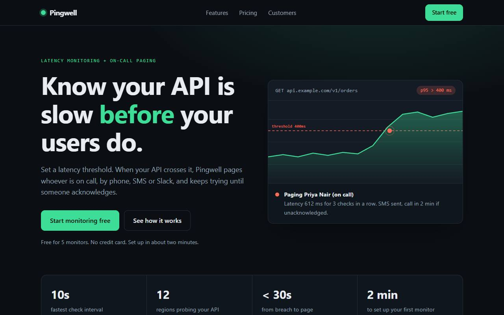
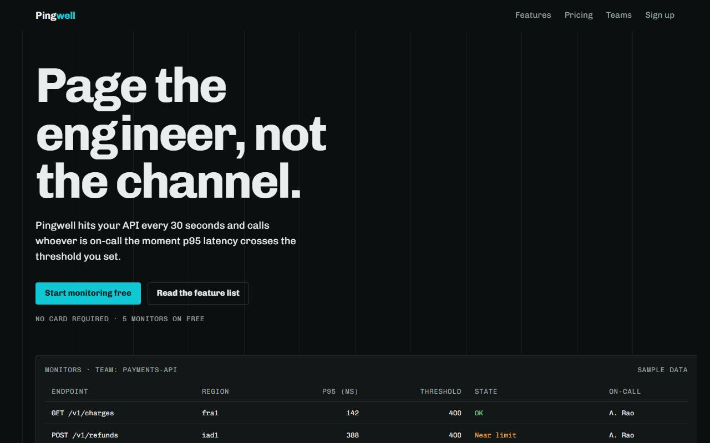

# sloplint

A zero-dependency linter for the patterns AI coding assistants leave behind: purple gradients and icon-circle grids, swallowed errors and N+1 queries, fallback secrets and wildcard CORS, filler copy, tests that cannot fail, and launch videos where everything fades in to the same whoosh.

| Claude Code alone | Same prompt, with `sloplint init --hooks` |
| --- | --- |
|  |  |

sloplint ships five things:

- **A CLI** that reports 43 deterministic rules with compiler-style diagnostics, a fix for every finding, autofixes where the fix is mechanical, and a weighted Slop Score from `0/100 Studio Grade` to `100/100 Critical Slop`.
- **A design-system generator** that gives every project its own `DESIGN.md`: a typeface trio, a contrast-checked palette, shape, motion and a layout archetype picked from a seed and a one-line brief, so agents stop converging on the same look. Two rules then hold the code to it.
- **Agent integrations**: a Claude Code plugin that lints every file as it is written, a skill for any agent that reads skills, rule blocks synced into `CLAUDE.md`, `GEMINI.md`, `AGENTS.md` and Cursor rules, master briefs per discipline, and a Playwright suite that audits the rendered page.
- **A GitHub Action** that annotates findings on pull requests and can send them to code scanning.
- **A docs site** ([sloplint.xyz](https://sloplint.xyz/)) with the rule catalog, worked examples, a style generator and an in-browser grader that runs the same engine as the CLI.

Help, false positives and release news: [Discord](https://discord.gg/2k669a6ebc).

```text
$ npx @sloplint/cli check examples/samples

error[SEC-001]: JWT_SECRET silently falls back to a hard-coded value
 --> examples/samples/api.slop.ts:9:20
  |
9 | const JWT_SECRET = process.env.JWT_SECRET || 'supersecretkey';
  |                    ^^^^^^^^^^^^^^^^^^^^^^^^^^^^^^^^^^^^^^^^^^
  = fix: Read secrets once at boot and crash if they are missing. Never ship a default for anything that signs, encrypts or authenticates.
  = autofix available (--fix)

Slop Score  ████████████████████████  100/100 Critical Slop
            8 files · 419 lines · 11 errors · 97 warnings · 18 autofixable
            UI 39  SEC 9  BE 14  COPY 28  TEST 9  MOTION 9
```

## Quick start

Node 20 or newer. Nothing else is installed at runtime. Installed as a dev dependency (`npm i -D @sloplint/cli`), the command is plain `sloplint`.

```bash
npx @sloplint/cli check .
```

```bash
npx @sloplint/cli init --brief "Invoicing for freelance studios" --hooks
```

```bash
npx @sloplint/cli explain SEC-001
```

### In Claude Code

```text
/plugin install sloplint --marketplace mattbaconz/sloplint
```

The plugin lints every file Claude writes, as it writes it, checks the files it wrote once more before it stops, and adds the sloplint skill. The one-step install needs Claude Code 2.1.275 or later; on older versions run `/plugin marketplace add mattbaconz/sloplint`, then `/plugin install sloplint@sloplint`. `init --hooks` installs the same hooks in a single project; use one or the other.

### In other agents

```bash
npx skills add mattbaconz/sloplint
```

installs the skill for Codex, Cursor and the other agents that read skills. It tells the agent to generate a `DESIGN.md` before writing UI and to run `sloplint check` before it finishes; `init` writes the rules into `AGENTS.md`, `GEMINI.md` and Cursor rules as well.

## Benchmark

Six tasks (landing page, REST API, dashboard, test suite, CLI README, launch video), run headless twice per cell, each in a fresh directory. `baseline` gets the prompt alone. `sloplint` adds `sloplint init --brief "<the prompt's first sentence>"` and a local install. `hooks` (Claude Code only) is `sloplint` plus `--hooks`. No prompt mentions sloplint.

2026-10-15, sloplint at `bf5982c`:

| Agent and model | Arm | Mean Slop Score | Findings | Mean turns | Mean cost | Mean time |
| --- | --- | --- | --- | --- | --- | --- |
| Claude Code, `claude-sonnet-5-5`, medium effort | baseline | 15.3 | 15 | 3.7 | $0.219 | 45s |
| | sloplint | 0.0 | 0 | 6.6 | $0.275 | 63s |
| | hooks | 0.0 | 0 | 6.1 | $0.277 | 66s |
| Antigravity, `gemini-3.8-flash-high` | baseline | 16.0 | 53 | n/a | n/a | 321s |
| | sloplint | 0.0 | 0 | n/a | n/a | 441s |

The same day, after fixing what the transcripts of that run showed (below):

| Agent and model | Arm | Mean Slop Score | Findings | Mean turns | Mean cost | Mean time |
| --- | --- | --- | --- | --- | --- | --- |
| Claude Code, `claude-sonnet-5-5`, medium effort | baseline | 18.4 | 24 | 4.0 | $0.210 | 45s |
| | hooks | 0.0 | 0 | 5.3 | $0.242 | 58s |

Every sloplint arm scored lower than its baseline on 3 or 4 of the 6 tasks and higher on none, with no suppressions. The baselines are where the findings come from: invented proof, filler copy, placeholder names, `transition: all`, proportional figures in tables, hard-coded secret fallbacks.

**Distinct looks.** Every baseline landing page used the system UI font or Plus Jakarta Sans, the two Gemini baselines were one template twice, once light and once dark (Plus Jakarta Sans, emerald `#10b981` glowing pill buttons, a version badge, the last headline word in a gradient), and one Claude baseline used Tailwind's indigo-600. The eight landing pages from sloplint arms used eight generated systems: four headline faces (Newsreader, Source Serif 4, Public Sans, Libre Franklin), call-to-action hues from 11° to 214°, no AI purple. All eight share one mood, since every brief was about invoicing, so they are related rather than random: the institutional mood now draws on six layouts instead of four, and the after-fix pages used Letter and Split.

**Bolder first screens.** Those pages were clean but looked like documents: the generator capped headlines near 49px, kept color to the call to action and told agents to choose the plainer option when DESIGN.md was silent. It now gives each mood a display step (up to 8rem), one named first-screen device per layout, a full-bleed color field, an ornament and a first-screen entrance. On 2026-10-16 Claude Code ran three new landing briefs (an uptime monitor, a bakery, a print studio) twice each, alone and with hooks. Claude alone built the same layout twice for each brief, and its pages scored 27.2 on average (unsourced proof, an icon-circle grid, proportional figures, a form that shows success without sending anything). With hooks, every page scored 0, and the six pages used five layouts from three moods for $0.053 more per run. One hooks page scrolled sideways at 375px because of a decorative shape; DESIGN.md now says to clip ornaments that bleed off an edge. The pair at the top of this page is the uptime brief, run 2: [all twelve pages](bench/results/2026-10-16-landing/README.md).

**Cost.** In the first run sloplint added $0.056 a run (+26%): $0.029 of cache writes (the instruction block, DESIGN.md, check output), $0.014 of cache reads for 2.4 to 2.9 more turns, and $0.012 of output. The transcripts showed where the turns went. Three false positives (UI-005 on a price styled by `.plan .price`, UI-012 on the Tailwind token class `font-[family-name:var(--font-mono)]`, SEC-003 on a constant column list) sent agents into fix loops that made the code worse: inline styles, expanded queries. Agents also re-ran the check after a fix because the hook said nothing when a file was clean. With those fixed, hooks cost $0.032 a run (+15%) and 1.3 more turns. Most of every run's cost is Claude Code itself: its system prompt and tools put about 33k tokens into the cache at the start of each session, $0.13 of the baseline's $0.21. Antigravity reports no cost; with sloplint it took 37% longer and read 32% more input tokens.

What the numbers do not show:

- **The metric is ours.** The sloplint arms are graded on the check they were told to pass. Checks that do not use sloplint held: suites killed 16 of 16 seeded mutants in 11 of 14 runs (one baseline, one Gemini sloplint and one Claude hooks run killed 15), every README documented all five real flags and invented none, and every API file parsed.
- **Invented proof, dressed up.** Gemini's sloplint pages put footnote markers on made-up figures ("98.4% first-pass match rate [1]") and credited a named testimonial to a "verified studio audit". That satisfies COPY-005's source check, which cannot tell a real source from an invented one. Claude's sloplint pages labelled their tables as sample data and left testimonials out or marked as drafts.
- **Layout at 375px.** Both Gemini baselines scroll sideways at 375px; neither Gemini sloplint page does. One Claude sloplint page did: its 12-column grid kept eleven 32px gaps on phones, 352px of gutter in a 327px column. UI-014 now flags that, DESIGN.md says to collapse grids below 768px, and no after-fix page overflowed.
- **Rules have moved since.** Each run is scored with the rules it was given. UI-013 (links to `#`), UI-014 and the badge check in COPY-006 came later; under today's rules the Gemini baseline pages would also carry 21 and 13 dead links.
- **Small samples.** Two runs per cell; treat small differences as noise. In the first run the runner's own Claude Code skills were available in every arm; the after-fix runs disable them.

| Gemini baseline | Gemini with sloplint |
| --- | --- |
|  |  |

Full results, every screenshot and the agent outputs: [2026-10-15](bench/results/2026-10-15/README.md) and [after the fixes](bench/results/2026-10-15-final/README.md); the earlier [2026-10-14](bench/results/2026-10-14/README.md) run predates the generated design systems. Method and how to rerun it: [bench/README.md](bench/README.md).

## Commands

### `sloplint check [paths...]`

Lints files and directories (default `.`) and prints one diagnostic per finding, then the score.

| Flag | Effect |
| --- | --- |
| `--fix` | Apply safe autofixes in place, then report what remains |
| `--changed` | Only files changed since the last commit: staged, unstaged and untracked (needs git) |
| `--format <f>` | `pretty` (default in a terminal), `compact` (default when piped: one line per finding, each fix once, then the score), `json`, `github` (GitHub Actions annotations, then the compact report) or `sarif` (SARIF 2.1.0 for code scanning) |
| `--max-score <n>` | Exit 1 when the score is above `n`; use `0` as a CI gate |
| `--no-color` | Plain output; `NO_COLOR` is honoured too |

Exit codes: `0` clean or warnings only, `1` errors or score above `--max-score`, `2` bad usage.

Scanned extensions: `.js .mjs .cjs .ts .mts .cts .jsx .tsx .html .htm .vue .svelte .astro .css .scss .less .py .md .mdx`. `node_modules`, build output, minified files, `.gitignore` entries and `.sloplintignore` entries are skipped.

### `sloplint init [dir]`

Writes `DESIGN.md` and syncs a compact rule block into the files agents read:

- `DESIGN.md`: a design system generated for this project, with tokens (`:root` custom properties and a Google Fonts import), type, color, layout, components, motion and an avoid list
- `CLAUDE.md`, `GEMINI.md`, `AGENTS.md`: a `sloplint` block between markers, one line per rule; your own content is preserved
- `.cursor/rules/sloplint.mdc`: the same block as an always-applied Cursor rule
- `.claude/settings.json`, with `--hooks`: the Claude Code hooks described under [`sloplint hook`](#sloplint-hook); other settings are kept

The design system comes from a seed and a one-line brief. The seed defaults to the package name plus a random suffix, so two projects called `my-app` still differ, and `DESIGN.md` records it; the brief defaults to the package description. Words in the brief pick one of seven moods: editorial, technical, warm, brutalist, luxe, playful or institutional. The seed then picks a typeface trio from that mood's curated Google Fonts pairings, an OKLCH palette solved for WCAG contrast (body text at least 12:1, secondary text, accent text and status colors at least 4.5:1) that stays out of the indigo-to-fuchsia band, a radius and shadow language, a layout archetype, two signature moves and a voice for the copy. The same seed and brief always give the same system.

| Flag | Effect |
| --- | --- |
| `--seed <text>` | Generate from this seed instead of the package name |
| `--brief <text>` | One line about the product; its words steer the mood |
| `--mood <name>` | Force a mood |
| `--mode light\|dark` | Force light or dark |
| `--preset <name>` | Use a curated preset instead of generating a system |
| `--hooks` | Add the Claude Code hooks |
| `--force` | Replace a `DESIGN.md` that sloplint did not write |

Re-running keeps the system recorded in `DESIGN.md`, so it is idempotent. A hand-written `DESIGN.md` is left alone unless you pass `--force`; the agent files then point at it. The rule block lists only what the project uses: motion-video rules appear when `remotion`, `@remotion/*` or `gsap` is a dependency, and UI rules are dropped for a project with dependencies but no front end.

The four curated presets:

| Preset | Alias | Character |
| --- | --- | --- |
| Obsidian Telemetry | `obsidian` | Dark instrument panel, amber signal color, IBM Plex |
| Editorial Serif | `editorial` | Paper and ink, oxblood accent, Newsreader headlines |
| Swiss Brutalist | `swiss` | White grid, signal red, square corners, Archivo |
| Tactile Hardware | `tactile` | Warm device shell, orange keys, soft inset depth |

All four define the same 17 tokens, so components written against one preset work under the others.

### `sloplint style`

Previews the system `init` would generate and writes nothing else. It takes `--seed`, `--brief`, `--mood` and `--mode` as `init` does, plus `--json` for the whole system as data and `--html <file>` for a specimen page with swatches, contrast ratios, the type scale and components.

```bash
npx @sloplint/cli style --brief "Recipes from a family bakery" --html design.html
```

### `sloplint explain [RULE]`

Without an argument, lists every rule. With one, prints the rationale, the fix and a side-by-side `✖ SLOP` / `✔ CRAFT` diff from the worked examples in `examples/`.

### `sloplint hook`

The command behind the Claude Code plugin and the hooks that `init --hooks` installs. After every `Write`, `Edit` or `MultiEdit` it lints the file just written, and when the agent stops it checks every file the session wrote (read from the session transcript; without one, the files changed since the last commit), so your own uncommitted work never blocks it. Findings reach the agent on stderr with exit code 2, in the compact format, so they are fixed in the same turn; a clean write is confirmed with `sloplint: <file> is clean.`, so the agent never spends a turn re-running the check. Unreadable input never blocks, and the second stop in a row always succeeds.

## Rules

| ID | Rule | Severity |
| --- | --- | --- |
| UI-001 | Purple/indigo gradient or glow used as the default accent | warn |
| UI-002 | Symmetrical 3-column grid of icon-badge feature cards | warn |
| UI-003 | Muted gray subtitle under nearly every heading | warn |
| UI-004 | Box-in-box border soup | warn |
| UI-005 | Numbers in tables or stats render with proportional digits | warn |
| UI-006 | Nested border radius is not concentric | warn |
| UI-007 | Transition on every property | warn |
| UI-008 | Spinner swaps out content and shifts layout | warn |
| UI-009 | Gradient-filled headline text | warn |
| UI-010 | Form shows success without sending anything | error |
| UI-011 | Color outside the DESIGN.md palette | warn |
| UI-012 | Typeface outside the DESIGN.md type system | warn |
| UI-013 | Link that goes nowhere | warn |
| UI-014 | Grid cannot fit a 375px screen | warn |
| UI-015 | Table pushes a 375px page sideways | warn |
| SEC-001 | Secret falls back to a hard-coded value | error |
| SEC-002 | CORS allows every origin | error |
| SEC-003 | SQL assembled from interpolated strings | error |
| SEC-004 | Raw request input interpolated into an LLM prompt | error |
| SEC-005 | Authentication decided in the browser | error |
| SEC-006 | Webhook handler never verifies the signature | error |
| SEC-007 | Interpolated values written as raw HTML | error |
| BE-001 | Error caught, logged and discarded | warn |
| BE-002 | Database query inside a loop (N+1) | warn |
| BE-003 | Outbound HTTP call without a timeout | warn |
| BE-004 | Mutation route that is unsafe to retry | warn |
| BE-005 | Stub, mock data or elided code in a production path | warn |
| BE-006 | Abstraction with exactly one implementation | warn |
| COPY-001 | LLM marketing filler in user-facing copy | warn |
| COPY-002 | Error message with no cause and no next step | warn |
| COPY-003 | Button or link label does not name the action | warn |
| COPY-004 | Template placeholder content shipped as real copy | warn |
| COPY-005 | Social proof or performance claim with no source | warn |
| COPY-006 | Emoji used as decoration in headings, buttons, links and badges | warn |
| TEST-001 | Test asserts only mocks, constants, or nothing | warn |
| TEST-002 | Fixed sleep in a test | warn |
| TEST-003 | Emoji-decorated README headings and bullets | warn |
| TEST-004 | Focused or skipped test committed | warn |
| MOTION-001 | Every element enters with the same fade | warn |
| MOTION-002 | List items staggered by a fixed step | warn |
| MOTION-003 | Springs and eases that overshoot by default | warn |
| MOTION-004 | Every scene has the same length | warn |
| MOTION-005 | The same sound effect on every cut | warn |
| MOTION-006 | Layered audio left at full volume | warn |

`UI-011` and `UI-012` run only when a `DESIGN.md` with a `:root` token block sits in the file's directory or above it, up to the repository root. They flag color literals, Tailwind palette classes and typefaces the design system does not define, and name the nearest token.

`MOTION-*` rules apply to videos written as code: files that import `remotion`, `@remotion/*` or `gsap`. They read the composition source; they do not analyse rendered video or audio.

Every rule has a slop and a craft example in `examples/`, and the test suite checks that each slop example triggers exactly its own rule and each craft example is clean.

### What the rules do not do

Detection is lexical, not type-aware. sloplint masks strings, comments and regex literals before matching, so it does not flag code that merely mentions a pattern, but it does not resolve imports or follow data flow across files. Each rule is tuned for a low false-positive rate over recall: when a finding is wrong, suppress it and open an issue with the snippet.

## Suppressions

Suppressions only count inside comments, and they name the rule:

```ts
// sloplint-disable-next-line SEC-002 -- public read-only API, no cookies
app.use(cors({ origin: '*' }));
```

`sloplint-disable-line` covers its own line, `sloplint-disable-next-line` the next one, and `sloplint-disable-file` the whole file. Omitting the rule ID suppresses every rule on that line.

## Slop Score

Each finding adds its rule's weight (errors 6 to 10, warnings 1 to 5) to a penalty. A rule counts at most three times per file, so one repeated pattern cannot dominate. The penalty is normalised for codebase size and mapped onto 0 to 100:

```text
k     = 24 × √max(1, lines / 800)
score = 0 if penalty is 0, else clamp(round(100 × (1 − e^(−penalty / k))), 1, 100)
```

Only a codebase with no findings scores 0.

| Score | Grade |
| --- | --- |
| 0 | Studio Grade |
| 1 to 19 | Minor Slop |
| 20 to 39 | Noticeable Slop |
| 40 to 59 | Sloppy |
| 60 to 79 | Heavy Slop |
| 80 to 100 | Critical Slop |

## In CI

The GitHub Action annotates each finding on the pull request diff and fails the check on errors, or on a score above `--max-score`:

```yaml
- uses: actions/checkout@v4
- uses: mattbaconz/sloplint@v0
  with:
    path: src             # files or directories, default .
    args: --max-score 20  # optional: any check flags
```

With `sarif: true` it also uploads the findings to code scanning, which needs `permissions: security-events: write`. It runs on the runner's Node, which GitHub-hosted runners include. Elsewhere:

```bash
npx @sloplint/cli check . --max-score 0
```

`--format sarif` writes SARIF 2.1.0 for other code-scanning dashboards.

## Rendered-page audit

Some slop only exists after the browser computes styles. `scripts/verify-dom.spec.ts` is a Playwright suite that checks a live page for `transition: all`, purple gradients and glows, gradient text, non-concentric radii, proportional digits, layout shift, filler copy, vague labels and overflow at 375px. It imports only `@playwright/test`:

```bash
SLOPLINT_URL=http://localhost:3000 npx playwright test e2e/verify-dom.spec.ts
```

See [rules/README.md](rules/README.md) for setup and for using the briefs with several agents.

## As a library

The engine has no Node imports and runs in the browser; the docs site imports it directly.

```js
import { lint, score, fixSource } from '@sloplint/cli';

const result = lint(source, 'src/app/page.tsx');
const { score: value, grade } = score([result]);
const { text, applied } = fixSource(source, 'src/app/page.tsx');
```

The path matters: it decides the language, and whether the file is a test, a server module or a README. Pass `{ design: parseDesign(designMarkdown) }` as the third argument to run the design-token rules; `generateStyle`, `designDoc`, `specimenHtml` and `parseDesign` come from `@sloplint/cli/design`.

## Docs site

```bash
npm run site
```

Then open `http://localhost:4173`. The site is static: `site/` plus the engine in `src/`, served from the repository root. It has no build step, so any static host that serves the repository works. The live copy is at https://sloplint.xyz/ (Vercel, from `vercel.json`) and https://mattbaconz.github.io/sloplint/ (GitHub Pages).

## Development

```bash
npm test
```

```bash
npm run check
```

```bash
npm run verify:dom
```

`npm test` runs the rule, CLI, init, design, scoring and dogfood suites with `node:test`. `npm run check` lints this repository and fails above 0. `npm run verify:dom` serves the site and audits it in every preset with Playwright. `npm run check:fonts` asks Google Fonts for every curated family and weight; it needs the network, so it is not part of `npm test`.

The repository is held to its own standard: `sloplint check .` scores `0/100 Studio Grade`, and a test fails if it does not. To add a rule or report a false positive, see [CONTRIBUTING.md](CONTRIBUTING.md).

## License

[MIT](LICENSE)
