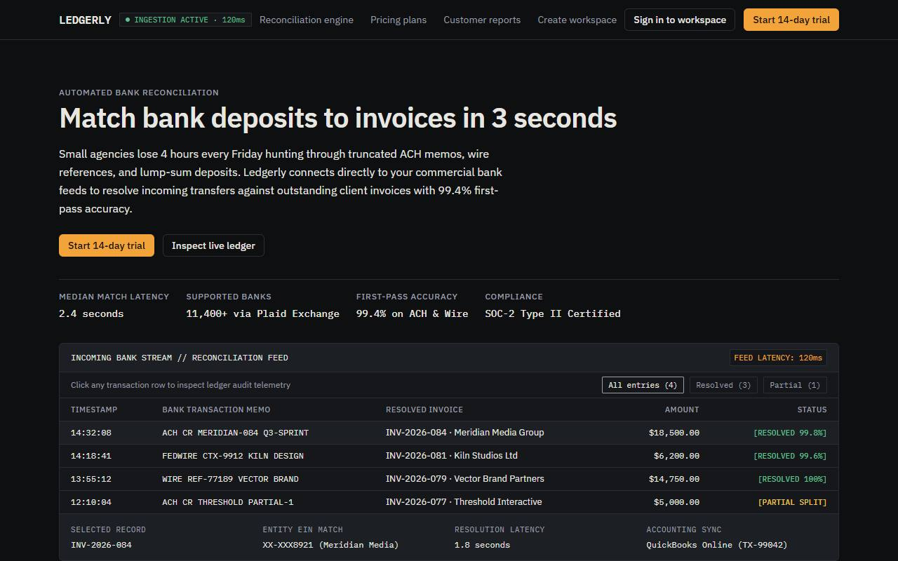
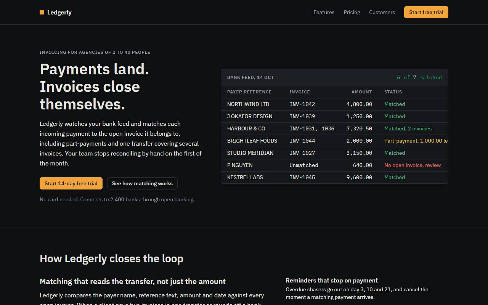
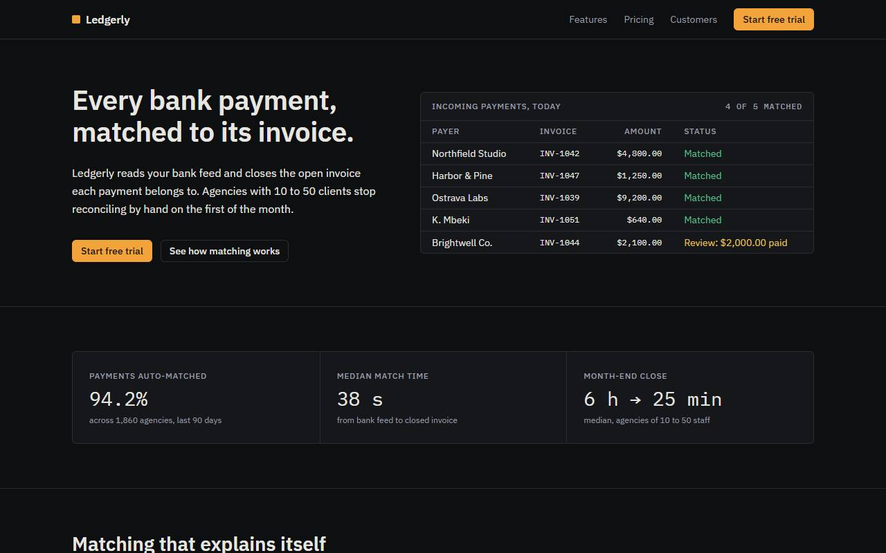

# Benchmark: 2026-10-14

Same prompt, same model, fresh directory per run. The `baseline` arm gets the task only; the `sloplint` arm also gets `sloplint init` and a local install. 48 scored runs, up to 2 per cell. Method and caveats: [bench/README.md](../../README.md).

## Summary

| Agent | Model | Arm | Mean Slop Score | Findings | Errors | Suppressions | Mean time | Mean tokens in/out |
| --- | --- | --- | --- | --- | --- | --- | --- | --- |
| agy | `gemini-3.8-flash-high` | baseline | 13.7 | 60 | 1 | 0 | 352s | 149k / 29.3k |
| agy | `gemini-3.8-flash-high` | sloplint | 0.0 | 0 | 0 | 0 | 473s | 197k / 36.2k |
| claude | `claude-sonnet-5-5` | baseline | 15.3 | 19 | 0 | 0 | 47s | 176k / 5.5k |
| claude | `claude-sonnet-5-5` | sloplint | 1.0 | 1 | 0 | 0 | 65s | 263k / 6.9k |

- **agy**: with sloplint, the mean score was lower on 2 of 6 tasks, equal on 4 and higher on 0.
- **claude**: with sloplint, the mean score was lower on 4 of 6 tasks, equal on 2 and higher on 0.

## Slop Score by task

Mean score per cell, lower is better; individual runs in brackets.

| Task | agy baseline | agy sloplint | claude baseline | claude sloplint |
| --- | --- | --- | --- | --- |
| api | 0 [0, 0] | 0 [0, 0] | 10 [19, 0] | 6 [0, 12] |
| dashboard | 25 [25, 25] | 0 [0, 0] | 12 [12, 12] | 0 [0, 0] |
| landing | 57 [61, 53] | 0 [0, 0] | 25 [28, 22] | 0 [0, 0] |
| readme | 0 [0, 0] | 0 [0, 0] | 0 [0, 0] | 0 [0, 0] |
| tests | 0 [0, 0] | 0 [0, 0] | 0 [0, 0] | 0 [0, 0] |
| video | 0 [0, 0] | 0 [0, 0] | 45 [44, 46] | 0 [0, 0] |

## Checks that do not use sloplint

| Task | Check | agy baseline | agy sloplint | claude baseline | claude sloplint |
| --- | --- | --- | --- | --- | --- |
| tests | Suite passes | yes, yes | yes, yes | yes, yes | yes, yes |
| tests | Mutants killed | 16/16, 16/16 | 16/16, 16/16 | 16/16, 16/16 | 15/16, 16/16 |
| readme | Real flags documented | 5/5, 5/5 | 5/5, 5/5 | 5/5, 5/5 | 5/5, 5/5 |
| readme | Invented flags | 0, 1 | 0, 0 | 0, 0 | 0, 0 |
| api | Syntax errors | 0, 0 | 0, 0 | 0, 0 | 0, 0 |
| landing | Overflows at 375px | yes, no | yes, yes | no, no | no, no |
| landing | Page errors | 0, 0 | 0, 0 | 0, 0 | 0, 0 |
| video | Files present | yes, yes | yes, yes | yes, yes | yes, yes |
| dashboard | File present | yes, yes | yes, yes | yes, yes | yes, yes |

## Rules hit

Findings per rule across all runs of each arm.

| Rule | agy baseline | agy sloplint | claude baseline | claude sloplint |
| --- | --- | --- | --- | --- |
| BE-004 non-idempotent-mutation | 0 | 0 | 1 | 0 |
| COPY-001 llm-buzzwords | 6 | 0 | 2 | 0 |
| COPY-002 dead-end-error | 2 | 0 | 2 | 1 |
| COPY-004 placeholder-content | 9 | 0 | 0 | 0 |
| MOTION-001 uniform-entrance | 0 | 0 | 1 | 0 |
| MOTION-003 bouncy-spring | 0 | 0 | 7 | 0 |
| MOTION-005 repeated-sfx | 0 | 0 | 1 | 0 |
| SEC-007 unsanitized-html | 1 | 0 | 0 | 0 |
| UI-001 neon-gradient | 3 | 0 | 0 | 0 |
| UI-002 icon-circle-grid | 2 | 0 | 2 | 0 |
| UI-003 redundant-subtitle | 1 | 0 | 0 | 0 |
| UI-004 border-soup | 3 | 0 | 0 | 0 |
| UI-005 missing-tabular-nums | 3 | 0 | 2 | 0 |
| UI-006 nonconcentric-radius | 0 | 0 | 1 | 0 |
| UI-007 transition-all | 27 | 0 | 0 | 0 |
| UI-009 gradient-text | 3 | 0 | 0 | 0 |

## Landing pages

First viewport at 1280px. Full outputs are under `runs/`.

**agy, run 1**

| baseline | sloplint |
| --- | --- |
|  |  |

**agy, run 2**

| baseline | sloplint |
| --- | --- |
|  |  |

**claude, run 1**

| baseline | sloplint |
| --- | --- |
|  |  |

**claude, run 2**

| baseline | sloplint |
| --- | --- |
|  |  |

