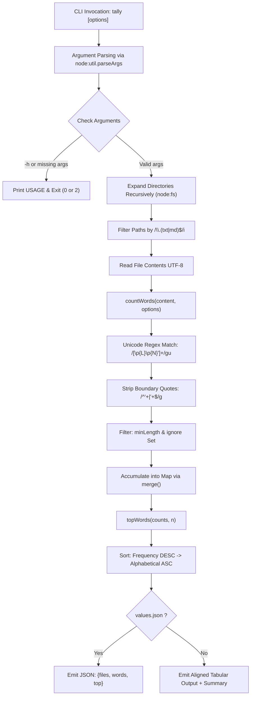

# tally-words

[](https://nodejs.org/)
[](LICENSE)
[]()
[]()

> A fast, lightweight, dependency-free Node.js CLI utility and programmatic library for counting and analyzing word frequencies across plain text (`.txt`) and Markdown (`.md`) files.

---

## Table of Contents

- [Overview](#overview)
- [Key Features](#key-features)
- [Tech Stack](#tech-stack)
- [Prerequisites](#prerequisites)
- [Getting Started & Installation](#getting-started--installation)
  - [Global CLI Installation](#global-cli-installation)
  - [One-Off Run with npx](#one-off-run-with-npx)
  - [Local Project Dependency](#local-project-dependency)
  - [From Source (Local Development)](#from-source-local-development)
- [CLI Reference](#cli-reference)
  - [Usage Syntax](#usage-syntax)
  - [Command-Line Options](#command-line-options)
  - [Exit Codes](#exit-codes)
  - [CLI Examples & Sample Output](#cli-examples--sample-output)
- [Programmatic API](#programmatic-api)
  - [Importing the Module](#importing-the-module)
  - [Function Reference](#function-reference)
    - [`countWords(text, options)`](#countwordstext-options)
    - [`merge(into, from)`](#mergeinto-from)
    - [`topWords(counts, n)`](#topwordscounts-n)
  - [Programmatic Code Example](#programmatic-code-example)
  - [TypeScript Definitions (Ambient Reference)](#typescript-definitions-ambient-reference)
- [Architecture & Internal Mechanics](#architecture--internal-mechanics)
  - [Directory Structure](#directory-structure)
  - [Processing Pipeline](#processing-pipeline)
  - [Tokenization & Normalization Algorithm](#tokenization--normalization-algorithm)
  - [Directory Discovery & File Filtering](#directory-discovery--file-filtering)
  - [Sorting & Tie-Breaking Logic](#sorting--tie-breaking-logic)
- [Available Scripts & Development](#available-scripts--development)
- [Testing](#testing)
  - [Running Tests with Node.js Native Test Runner](#running-tests-with-nodejs-native-test-runner)
  - [Automated Test Suite Example](#automated-test-suite-example)
  - [CLI Integration Testing](#cli-integration-testing)
- [Publishing & Distribution](#publishing--distribution)
  - [Publishing to npm](#publishing-to-npm)
  - [Docker Containerization](#docker-containerization)
  - [GitHub Actions CI/CD](#github-actions-cicd)
- [Troubleshooting & FAQ](#troubleshooting--faq)
- [Contributing](#contributing)
- [License](#license)

---

## Overview

**tally-words** (executable as `tally`) is designed for developers, technical writers, researchers, and content teams who need to analyze word frequency distributions across single files or large file trees.

Built entirely using native Node.js APIs (`node:fs`, `node:path`, and `node:util`), `tally-words` requires **zero external dependencies**. It processes Unicode text with full international support, handles contractions and quotes cleanly, allows filtering by minimum word length and stop-word ignore lists, and provides both formatted tabular terminal summaries and structured JSON output.

---

## Key Features

- **Zero External Dependencies**: Operates entirely on built-in Node.js v20+ standard library modules (`node:fs`, `node:path`, `node:util`).
- **Recursive Directory Ingestion**: Accepts individual file paths and directories; automatically walks directory hierarchies.
- **Smart File Filtering**: Targets `.txt` and `.md` files automatically, skipping binaries and irrelevant file types.
- **Unicode-Aware Tokenization**: Correctly tokenizes multi-lingual words and digits across alphabets using ECMAScript Unicode property escapes (`\p{L}` and `\p{N}`).
- **Intelligent Punctuation & Contraction Handling**: Retains internal apostrophes (such as `it's`, `don't`, or `user's`) while stripping surrounding single quotes and punctuation (`'quote'` → `quote`).
- **Flexible Filters**:
  - Filter out short words via `--min-length <n>`.
  - Exclude stop words via repeatable `--ignore <word>` flags.
- **Configurable Ranking**: Sorts by descending frequency with deterministic alphabetical tie-breaking via `--top <n>`.
- **Dual Output Modes**:
  - **Human-Readable Table**: Dynamically padded column layout showing word frequencies and document metrics.
  - **Machine-Readable JSON**: `--json` flag formats output for easy piping into `jq`, data science workflows, or web APIs.
- **Programmatic ESM Library**: Exported functions (`countWords`, `merge`, `topWords`) can be embedded directly in Node.js applications.

---

## Tech Stack

| Component | Technology | Description |
| :--- | :--- | :--- |
| **Runtime** | [Node.js](https://nodejs.org/) (>= 20.0.0) | Uses modern ECMAScript standard library features |
| **Module System** | Native ESM (`"type": "module"`) | Standard ECMAScript Modules (`import` / `export`) |
| **CLI Parser** | `node:util.parseArgs` | Built-in zero-dependency CLI option and positional argument parser |
| **File System** | `node:fs` (synchronous) | Native `readFileSync`, `statSync`, and `readdirSync` |
| **Path Utilities** | `node:path` | Cross-platform directory joining via `join` |
| **Dependencies** | *None* | 0 third-party packages installed |

---

## Prerequisites

- **Node.js**: Version **20.0.0** or higher is required (configured in `package.json` under `"engines": { "node": ">=20" }`).
  
  Verify your current Node version:
  ```bash
  node --version
  ```
- **Package Manager**: `npm` (bundled with Node.js), `pnpm`, or `yarn`.

---

## Getting Started & Installation

### Global CLI Installation

To install `tally` globally on your system:

```bash
npm install -g tally-words
```

After installation, the `tally` command will be accessible anywhere in your terminal:

```bash
tally --help
```

### One-Off Run with npx

You can run `tally-words` without installing it permanently:

```bash
npx tally-words --top 10 ./notes
```

### Local Project Dependency

To use `tally-words` programmatically in your own Node.js project:

```bash
npm install tally-words
```

### From Source (Local Development)

If you are developing or modifying `tally-words` directly from the source repository:

1. **Clone the repository**:
   ```bash
   git clone https://github.com/username/tally-words.git
   cd tally-words
   ```

2. **Verify Node.js version**:
   ```bash
   node -v
   # Must be >= v20.0.0
   ```

3. **Install dependencies**:
   ```bash
   npm install
   # (No runtime dependencies to download; verifies environment)
   ```

4. **Link the executable locally**:
   ```bash
   npm link
   ```
   This registers the `tally` symlink in your global npm path pointing to `bin/tally.js`.

5. **Test the executable**:
   ```bash
   tally -h
   ```

   Alternatively, invoke the entry script directly:
   ```bash
   node bin/tally.js -h
   ```

---

## CLI Reference

### Usage Syntax

```bash
tally [options] <file|dir>...
```

You can pass one or more file paths, directory paths, or any combination of both.

### Command-Line Options

| Option | Type | Default | Description |
| :--- | :--- | :--- | :--- |
| `--top <n>` | `string` (parsed as number) | `10` | Show the `n` most frequent words. |
| `--min-length <n>` | `string` (parsed as number) | `1` | Ignore words shorter than `n` characters. |
| `--ignore <word>` | `string` (repeatable array) | `[]` | Exclude a word from the tally. Repeat `--ignore` to exclude multiple words. Case-insensitive. |
| `--json` | `boolean` | `false` | Output results formatted as JSON (`{"files", "words", "top"}`). |
| `-h`, `--help` | `boolean` | `false` | Display help and usage instructions. |

### Exit Codes

| Exit Code | Meaning | Cause |
| :---: | :--- | :--- |
| `0` | **Success** | Successful execution, or `--help` / `-h` was requested. |
| `2` | **Invalid Invocation** | No positional file or directory arguments were provided to the command. |
| `1` | **Runtime Error** | Uncaught file system error (e.g. `ENOENT` for a non-existent path or permission denial). |

---

### CLI Examples & Sample Output

#### 1. Basic Single-File Analysis

Analyze a single Markdown file with default settings (top 10 words):

```bash
tally README.md
```

**Output:**
```text
the          18
words        14
node         10
and           9
files         8
tally         7
options       6
count         5
cli           4
json          4

1 files, 142 distinct words
```

#### 2. Scanning an Entire Directory Recursively

Pass any folder path. `tally` recursively discovers all `.txt` and `.md` files in nested subfolders:

```bash
tally ./docs
```

**Output:**
```text
api          42
function     35
returns      28
options      21
type         19
string       18
value        15
data         12
file         11
default      10

8 files, 487 distinct words
```

#### 3. Filtering by Minimum Word Length

Exclude short words (e.g., words shorter than 5 characters):

```bash
tally --min-length 5 README.md
```

**Output:**
```text
words        14
options       6
distinct      3
frequency     3
programmatic  3
...
```

#### 4. Excluding Stop Words (`--ignore`)

Repeat the `--ignore` flag to filter out common English articles or pronouns:

```bash
tally --ignore the --ignore and --ignore of --ignore to --ignore in README.md
```

**Output:**
```text
words        14
node         10
files         8
tally         7
options       6
count         5
cli           4
json          4
module        3
support       3

1 files, 137 distinct words
```

#### 5. Outputting as Machine-Readable JSON

Use `--json` to produce structured JSON data:

```bash
tally --top 3 --json README.md
```

**Output:**
```json
{
  "files": 1,
  "words": 142,
  "top": {
    "the": 18,
    "words": 14,
    "node": 10
  }
}
```

#### 6. Integrating with Shell Pipelines (`jq`)

Extract just the top word and its frequency using `jq`:

```bash
tally --json ./docs | jq '.top | to_entries[0]'
```

**Output:**
```json
{
  "key": "api",
  "value": 42
}
```

#### 7. Combining Multiple Files and Folders

Mix individual files and directories on the command line:

```bash
tally notes.txt ./articles ./documentation/guide.md
```

---

## Programmatic API

In addition to the CLI, `tally-words` exports its core functional modules from `src/count.js`.

### Importing the Module

```javascript
import { countWords, merge, topWords } from 'tally-words/src/count.js';
// Or when working within the repository:
// import { countWords, merge, topWords } from './src/count.js';
```

---

### Function Reference

#### `countWords(text, options)`

Tokenizes a plain text string and returns a `Map` of word frequencies.

```javascript
function countWords(
  text: string,
  options?: {
    minLength?: number,
    ignore?: string[]
  }
): Map<string, number>
```

- **Parameters**:
  - `text` *(string)*: The raw input text to analyze.
  - `options` *(object, optional)*:
    - `minLength` *(number, default: `1`)*: Minimum character length required for a word to be counted.
    - `ignore` *(Array<string>, default: `[]`)*: Array of words to exclude. Matching is case-insensitive.
- **Returns**: `Map<string, number>`: A `Map` mapping each normalized lowercase word to its occurrence count.
- **Behavior**:
  - Words match the Unicode regex `/[\p{L}\p{N}']+/gu`.
  - Leading and trailing apostrophes are stripped (`/^'+|'+$/g`), preserving internal contractions like `don't` or `it's`.
  - Words are lowercased before counting and ignore matching.

---

#### `merge(into, from)`

Merges counts from one `Map` into another. Modifies and returns the destination map.

```javascript
function merge(
  into: Map<string, number>,
  from: Map<string, number>
): Map<string, number>
```

- **Parameters**:
  - `into` *(Map<string, number>)*: The target accumulator map (mutated in place).
  - `from` *(Map<string, number>)*: The source frequency map whose counts will be added into `into`.
- **Returns**: `Map<string, number>`: The mutated `into` map reference.

---

#### `topWords(counts, n)`

Sorts a frequency map and extracts the top `n` most frequent words.

```javascript
function topWords(
  counts: Map<string, number>,
  n: number
): Array<[string, number]>
```

- **Parameters**:
  - `counts` *(Map<string, number>)*: Word frequency map.
  - `n` *(number)*: Number of top entries to return.
- **Returns**: `Array<[string, number]>`: An array of `[word, count]` tuples sliced to length `n`.
- **Sorting Rule**:
  1. **Primary**: Frequency descending (`countB - countA`).
  2. **Tie-Breaker**: Alphabetical ascending via `localeCompare` (`wordA.localeCompare(wordB)`).

---

### Programmatic Code Example

```javascript
import { countWords, merge, topWords } from './src/count.js';

// 1. Analyze a string of text
const text1 = "The quick brown fox jumps over the lazy dog. The dog slept.";
const counts1 = countWords(text1, {
  minLength: 3,
  ignore: ['the']
});

console.log("Counts 1:", Object.fromEntries(counts1));
// Output: { quick: 1, brown: 1, fox: 1, jumps: 1, over: 1, lazy: 1, dog: 2, slept: 1 }

// 2. Analyze another chunk and merge
const text2 = "Another lazy dog was barking at another fox!";
const counts2 = countWords(text2, { minLength: 3, ignore: ['the'] });

const totalCounts = merge(counts1, counts2);

// 3. Extract top 3 words
const top3 = topWords(totalCounts, 3);
console.log("Top 3 words:", top3);
// Output: [ [ 'dog', 3 ], [ 'another', 2 ], [ 'fox', 2 ] ]
```

---

### TypeScript Definitions (Ambient Reference)

If integrating into a TypeScript codebase, you can declare the module types as follows:

```typescript
declare module 'tally-words/src/count.js' {
  export interface CountOptions {
    minLength?: number;
    ignore?: string[];
  }

  export function countWords(
    text: string,
    options?: CountOptions
  ): Map<string, number>;

  export function merge(
    into: Map<string, number>,
    from: Map<string, number>
  ): Map<string, number>;

  export function topWords(
    counts: Map<string, number>,
    n: number
  ): Array<[string, number]>;
}
```

---

## Architecture & Internal Mechanics

### Directory Structure

```text
tally-words/
├── bin/
│   └── tally.js         # Executable CLI script (shebang, argument parsing, I/O)
├── src/
│   └── count.js         # Core library logic (tokenization, merging, ranking)
├── package.json         # Package configuration, CLI bin mapping, engines
└── README.md            # Comprehensive project documentation
```

---

### Processing Pipeline



---

### Tokenization & Normalization Algorithm

Word extraction in `src/count.js` uses a resilient multi-stage tokenization strategy:

1. **Case Normalization**:
   The entire input string is transformed to lowercase via `.toLowerCase()`. Ignore list terms are similarly normalized into a `Set` for $O(1)$ lookups.

2. **Unicode Pattern Matching**:
   ```javascript
   text.toLowerCase().matchAll(/[\p{L}\p{N}']+/gu)
   ```
   - `\p{L}`: Matches any Unicode letter in any script (Latin, Greek, Cyrillic, CJK, Arabic, etc., including accented characters like `é`, `ñ`, `ü`).
   - `\p{N}`: Matches any Unicode numeric character or digit.
   - `'`: Matches apostrophes.
   - `u` flag: Enables full Unicode property support.

3. **Boundary Quote Stripping**:
   ```javascript
   const word = match[0].replace(/^'+|'+$/g, '');
   ```
   Words enclosed in quotes like `'hello'` or `'world'` are cleanly trimmed to `hello` and `world`, while retaining contractions like `don't`, `it's`, `rock'n'roll`, and possessive nouns like `alice's`.

4. **Constraint Filtering**:
   ```javascript
   if (word.length < minLength || skip.has(word)) continue;
   ```
   Tokens below `minLength` or present in the `ignore` list are skipped before incrementing the frequency counter.

---

### Directory Discovery & File Filtering

`bin/tally.js` implements a recursive tree traversal using Node's standard file system methods:

```javascript
const files = positionals.flatMap(function expand(path) {
  return statSync(path).isDirectory()
    ? readdirSync(path).flatMap((name) => expand(join(path, name)))
    : [path];
}).filter((path) => /\.(txt|md)$/i.test(path));
```

- If an entry is a directory (`statSync(path).isDirectory()`), it reads each entry within the directory and recursively expands it.
- If an entry is a file, it yields `[path]`.
- All candidate file paths are tested against the case-insensitive regular expression `/\.(txt|md)$/i`. Files with extensions such as `.json`, `.js`, `.png`, or directories without matching files are excluded from processing.

---

### Sorting & Tie-Breaking Logic

`topWords` in `src/count.js` guarantees deterministic results:

```javascript
export function topWords(counts, n) {
  return [...counts]
    .sort((a, b) => b[1] - a[1] || a[0].localeCompare(b[0]))
    .slice(0, n);
}
```

- **Frequency Sorting**: `b[1] - a[1]` ensures the highest word counts appear first.
- **Alphabetical Tie-Breaker**: When two words share identical frequencies (`b[1] === a[1]`), `a[0].localeCompare(b[0])` sorts them alphabetically in ascending lexicographical order.

---

## Available Scripts & Development

The project operates cleanly without third-party dev dependencies. Below are common commands for local development:

| Command | Purpose |
| :--- | :--- |
| `node bin/tally.js -h` | Run the CLI script directly using Node |
| `node bin/tally.js --top 5 <path>` | Test CLI execution on a file or folder |
| `npm link` | Create a global symlink to `bin/tally.js` for development |
| `npm unlink -g tally-words` | Remove the global symlink |
| `npm pack` | Create a tarball (`tally-words-1.2.0.tgz`) to inspect packaged files |

---

## Testing

Node.js v20+ includes a built-in test runner (`node:test`) and assertion library (`node:assert`). You do not need Jest, Mocha, or Vitest.

### Running Tests with Node.js Native Test Runner

Create a test file `test/count.test.js` and execute:

```bash
node --test
```

### Automated Test Suite Example

Below is a complete test suite for `src/count.js`:

```javascript
// test/count.test.js
import test from 'node:test';
import assert from 'node:assert/strict';
import { countWords, merge, topWords } from '../src/count.js';

test('countWords: basic sentence tokenization', () => {
  const counts = countWords('Hello world! Hello node.');
  assert.equal(counts.get('hello'), 2);
  assert.equal(counts.get('world'), 1);
  assert.equal(counts.get('node'), 1);
});

test('countWords: strips surrounding quotes but preserves contractions', () => {
  const counts = countWords("'quoted' and it's don't");
  assert.equal(counts.get('quoted'), 1);
  assert.equal(counts.get("it's"), 1);
  assert.equal(counts.get("don't"), 1);
  assert.equal(counts.has("'quoted'"), false);
});

test('countWords: respects minLength', () => {
  const counts = countWords('a bb ccc dddd', { minLength: 3 });
  assert.equal(counts.has('a'), false);
  assert.equal(counts.has('bb'), false);
  assert.equal(counts.get('ccc'), 1);
  assert.equal(counts.get('dddd'), 1);
});

test('countWords: ignores specified stop words', () => {
  const counts = countWords('The quick brown fox', { ignore: ['the'] });
  assert.equal(counts.has('the'), false);
  assert.equal(counts.get('quick'), 1);
});

test('countWords: handles Unicode characters and accents', () => {
  const counts = countWords('Café naïve Über 123');
  assert.equal(counts.get('café'), 1);
  assert.equal(counts.get('naïve'), 1);
  assert.equal(counts.get('über'), 1);
  assert.equal(counts.get('123'), 1);
});

test('merge: combines multiple frequency maps', () => {
  const mapA = new Map([['apple', 2], ['banana', 1]]);
  const mapB = new Map([['apple', 3], ['cherry', 4]]);
  const result = merge(mapA, mapB);

  assert.equal(result.get('apple'), 5);
  assert.equal(result.get('banana'), 1);
  assert.equal(result.get('cherry'), 4);
});

test('topWords: sorts by frequency and breaks ties alphabetically', () => {
  const counts = new Map([
    ['banana', 2],
    ['apple', 2],
    ['cherry', 5],
    ['date', 1],
  ]);

  const top = topWords(counts, 3);
  assert.deepEqual(top, [
    ['cherry', 5],
    ['apple', 2],
    ['banana', 2],
  ]);
});
```

### CLI Integration Testing

You can test CLI exit codes and behavior directly in your terminal:

```bash
# Verify exit code 2 on missing arguments
node bin/tally.js
echo $? # On Unix/macOS: 2 | In PowerShell: $LASTEXITCODE -> 2

# Verify exit code 0 on --help
node bin/tally.js --help
echo $? # 0
```

---

## Publishing & Distribution

### Publishing to npm

1. **Verify your package contents**:
   Ensure `package.json` includes required fields. Inspect files before publishing:
   ```bash
   npm pack --dry-run
   ```

2. **Log in to npm**:
   ```bash
   npm login
   ```

3. **Publish**:
   ```bash
   npm publish
   ```

---

### Docker Containerization

To run `tally-words` in a containerized environment (for CI pipelines or container-based workloads), use the following minimal `Dockerfile`:

```dockerfile
# Use minimal official Node.js Alpine image
FROM node:20-alpine

# Set working directory
WORKDIR /app

# Copy project files
COPY package.json ./
COPY bin/ ./bin/
COPY src/ ./src/

# Make binary executable and link globally
RUN chmod +x bin/tally.js && npm link

# Set entrypoint
ENTRYPOINT ["tally"]
CMD ["--help"]
```

**Build and Run**:
```bash
# Build the Docker image
docker build -t tally-words .

# Mount a local folder into the container to analyze files
docker run --rm -v "$(pwd)/docs:/data" tally-words /data
```

---

### GitHub Actions CI/CD

Example workflow (`.github/workflows/ci.yml`) to validate the CLI across Node versions on Linux, macOS, and Windows:

```yaml
name: CI

on:
  push:
    branches: [main]
  pull_request:
    branches: [main]

jobs:
  test:
    runs-on: ${{ matrix.os }}
    strategy:
      matrix:
        os: [ubuntu-latest, macos-latest, windows-latest]
        node-version: [20.x, 22.x]

    steps:
      - name: Checkout repository
        uses: actions/checkout@v4

      - name: Setup Node.js ${{ matrix.node-version }}
        uses: actions/setup-node@v4
        with:
          node-version: ${{ matrix.node-version }}

      - name: Verify CLI Help Output
        run: node bin/tally.js --help

      - name: Verify Exit Code on Empty Invocation
        shell: bash
        run: |
          node bin/tally.js && exit 1 || test $? -eq 2
```

---

## Troubleshooting & FAQ

### 1. `Error: ENOENT: no such file or directory, stat 'path'`
**Cause**: One of the files or directories passed as an argument does not exist.  
**Solution**: Verify the path exists before invoking `tally`. Ensure paths with spaces are enclosed in quotation marks (e.g. `tally "My Documents/notes.txt"`).

---

### 2. Why was my file skipped or counted as 0 files?
**Cause**: `tally` explicitly filters files by extension: `/\.(txt|md)$/i`.  
**Solution**: Ensure your target files end with `.txt` or `.md`. If you pass a directory containing only `.html` or `.json` files, `tally` will report `0 files, 0 distinct words`.

---

### 3. `SyntaxError: Unexpected token '?'` or Node Version Mismatch
**Cause**: Running on an outdated Node.js runtime (v18 or earlier) that does not support modern ESM features or `util.parseArgs` options used by `tally`.  
**Solution**: Upgrade Node.js to `v20.0.0` or higher using `nvm`, `asdf`, or your package manager:
```bash
nvm install 20
nvm use 20
```

---

### 4. `EACCES: permission denied` when running `./bin/tally.js` on Linux/macOS
**Cause**: The executable permission bit is missing on `bin/tally.js`.  
**Solution**: Run:
```bash
chmod +x bin/tally.js
```

---

### 5. Why is `--ignore` not working for multiple words?
**Cause**: Passing multiple words in a single flag string without quoting or using commas.  
**Solution**: Repeat the `--ignore` flag for each word you wish to exclude:
```bash
# Correct:
tally --ignore the --ignore and --ignore with notes.txt

# Do not use: --ignore "the, and, with"
```

---

## Contributing

Contributions and improvements are welcome!

1. Fork the repository.
2. Create a feature branch: `git checkout -b feature/my-feature`.
3. Verify your changes work with Node.js >= 20.
4. Keep dependencies at zero (`0` external packages).
5. Submit a pull request with a clear description of your improvements.

---

## License

This project is licensed under the **MIT License**. See the [LICENSE](LICENSE) file or `package.json` for details.
