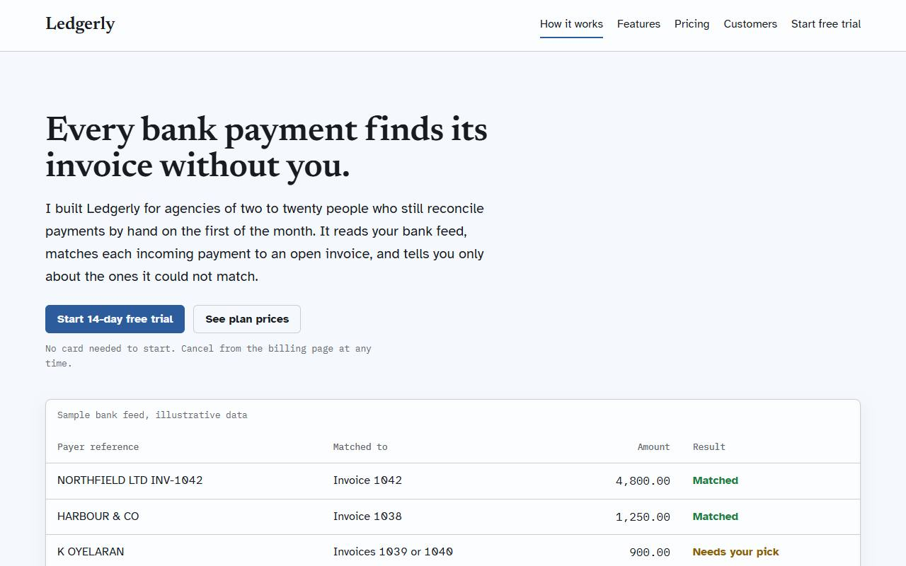
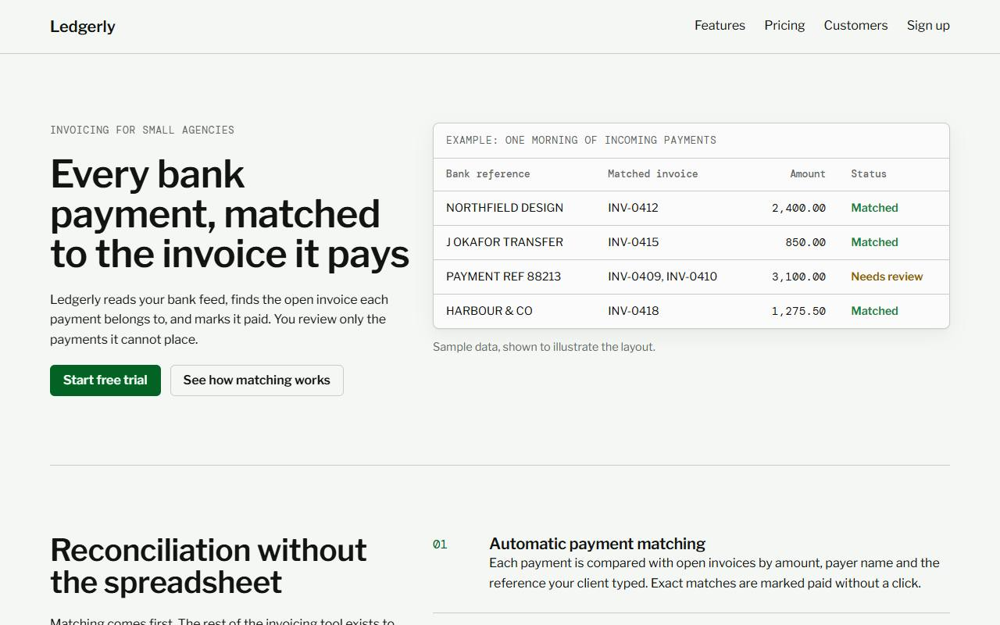

# Benchmark: 2026-10-15

Same prompt, same model, fresh directory per run. `baseline` gets the task only; `sloplint` also gets `sloplint init --brief <the prompt's first sentence>` and a local install; `hooks` is `sloplint` plus `--hooks` (Claude Code only). 24 scored runs, up to 2 per cell. Method and caveats: [bench/README.md](../../README.md).

## Summary

| Agent | Model | Arm | Mean Slop Score | Findings | Errors | Suppressions | Mean time | Mean turns | Mean tokens in/out | Mean cost |
| --- | --- | --- | --- | --- | --- | --- | --- | --- | --- | --- |
| claude | `claude-sonnet-5-5` | baseline | 18.4 | 24 | 2 | 0 | 45s | 4.0 | 172k / 5.3k | $0.210 |
| claude | `claude-sonnet-5-5` | hooks | 0.0 | 0 | 0 | 0 | 58s | 5.3 | 270k / 5.5k | $0.242 |

- **claude hooks** against baseline: the mean score was lower on 4 of 6 tasks, equal on 2 and higher on 0.

## Slop Score by task

Mean score per cell, lower is better; individual runs in brackets.

| Task | claude baseline | claude hooks |
| --- | --- | --- |
| api | 23 [46, 0] | 0 [0, 0] |
| dashboard | 12 [12, 12] | 0 [0, 0] |
| landing | 56 [55, 57] | 0 [0, 0] |
| readme | 0 [0, 0] | 0 [0, 0] |
| tests | 0 [0, 0] | 0 [0, 0] |
| video | 20 [31, 8] | 0 [0, 0] |

## Checks that do not use sloplint

| Task | Check | claude baseline | claude hooks |
| --- | --- | --- | --- |
| tests | Suite passes | yes, yes | yes, yes |
| tests | Mutants killed | 15/16, 16/16 | 16/16, 16/16 |
| readme | Real flags documented | 5/5, 5/5 | 5/5, 5/5 |
| readme | Invented flags | 0, 0 | 0, 0 |
| api | Syntax errors | 0, 0 | 0, 0 |
| landing | Overflows at 375px | no, no | no, no |
| landing | Page errors | 0, 0 | 0, 0 |
| video | Files present | yes, yes | yes, yes |
| dashboard | File present | yes, yes | yes, yes |

## Landing page look

Declared headline and body typefaces, and the fill of the first filled link or button (the primary call to action), read from the rendered page. "AI purple" is the saturated indigo-to-violet band of UI-001.

| Agent | Arm | Run | Design system | Headline face | Body face | CTA fill |
| --- | --- | --- | --- | --- | --- | --- |
| claude | baseline | 1 | none | -apple-system | -apple-system | `#0f766e` hue 175 |
| claude | baseline | 2 | none | system-ui | system-ui | `#0f6b5c` hue 170 |
| claude | hooks | 1 | Charter Letter | Newsreader | Atkinson Hyperlegible | `#2c5c9c` hue 214 |
| claude | hooks | 2 | Registry Split | Libre Franklin | DM Mono | `#026325` hue 142 |

- **claude baseline**: 2 distinct headline faces in 2 pages (-apple-system, system-ui); 0 AI-purple calls to action.
- **claude hooks**: 2 distinct headline faces in 2 pages (Newsreader, Libre Franklin); 0 AI-purple calls to action.

## Rules hit

Findings per rule across all runs of each arm.

| Rule | claude baseline | claude hooks |
| --- | --- | --- |
| BE-002 n-plus-one | 1 | 0 |
| COPY-001 llm-buzzwords | 1 | 0 |
| COPY-002 dead-end-error | 2 | 0 |
| COPY-005 invented-proof | 8 | 0 |
| MOTION-003 bouncy-spring | 4 | 0 |
| SEC-001 fallback-secret | 1 | 0 |
| UI-002 icon-circle-grid | 2 | 0 |
| UI-005 missing-tabular-nums | 2 | 0 |
| UI-006 nonconcentric-radius | 2 | 0 |
| UI-010 fake-success | 1 | 0 |

## Landing pages

First viewport at 1280px. Full outputs are under `runs/`.

**claude, run 1**

| baseline | hooks |
| --- | --- |
|  |  |

**claude, run 2**

| baseline | hooks |
| --- | --- |
|  |  |

