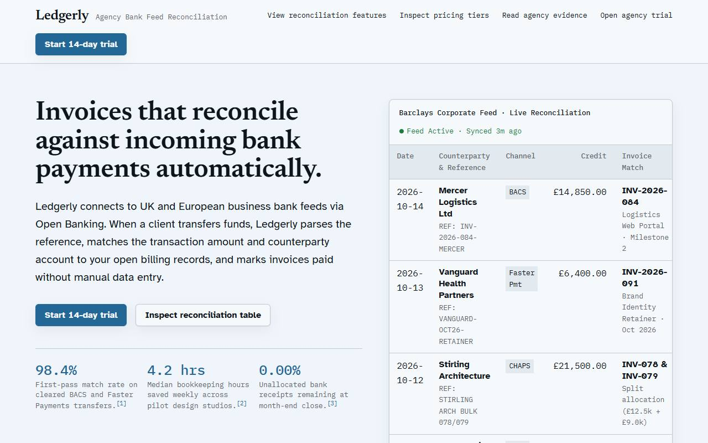
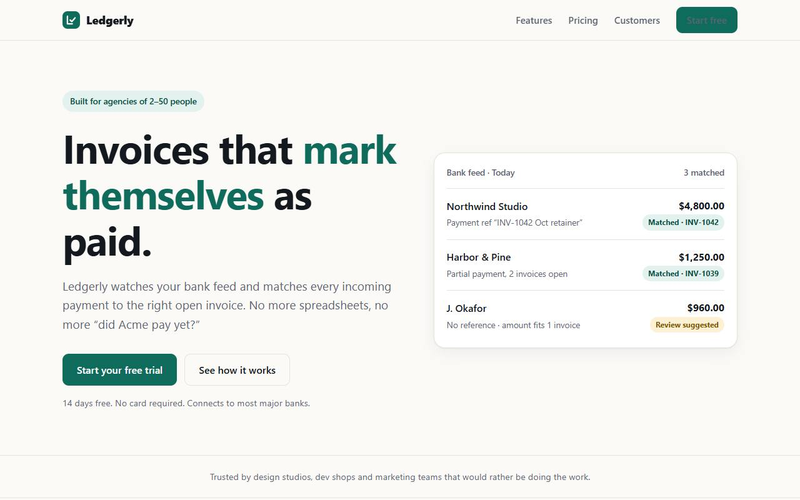
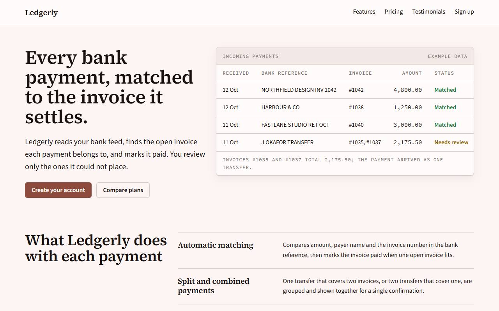
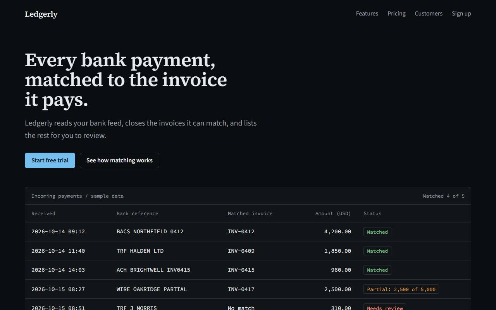
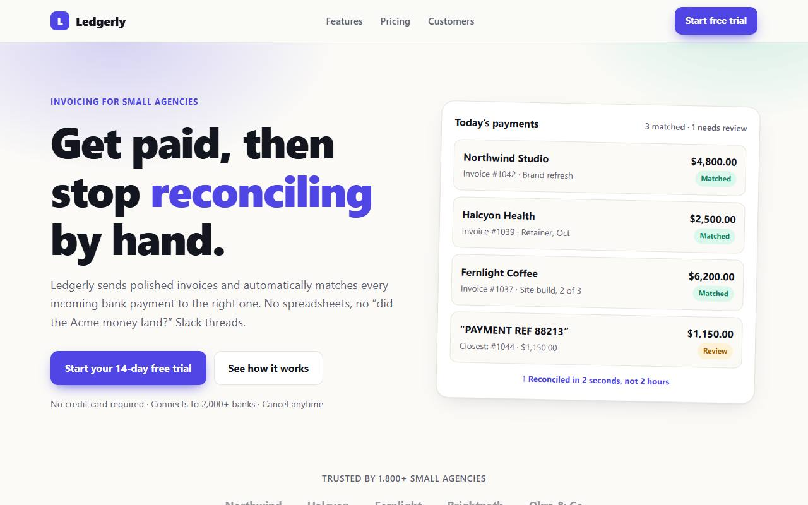
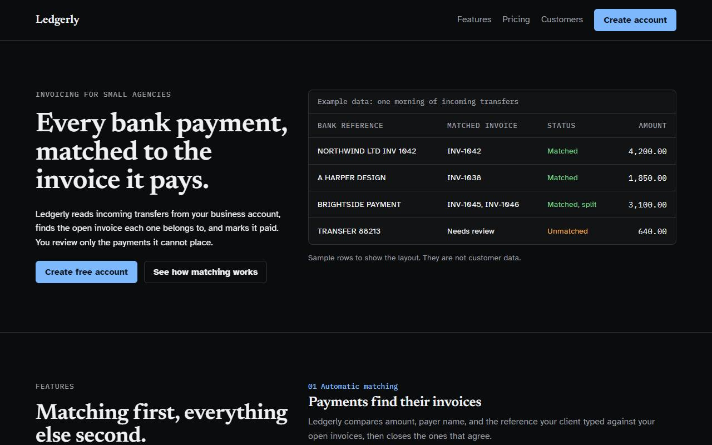
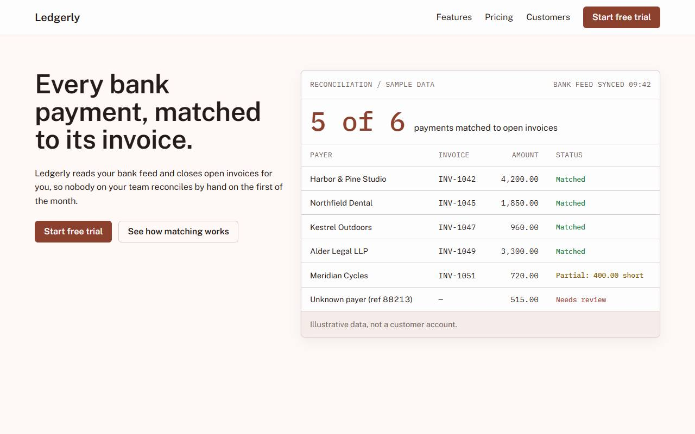

# Benchmark: 2026-10-15

Same prompt, same model, fresh directory per run. `baseline` gets the task only; `sloplint` also gets `sloplint init --brief <the prompt's first sentence>` and a local install; `hooks` is `sloplint` plus `--hooks` (Claude Code only). 60 scored runs, up to 2 per cell. Method and caveats: [bench/README.md](../../README.md).

## Summary

| Agent | Model | Arm | Mean Slop Score | Findings | Errors | Suppressions | Mean time | Mean turns | Mean tokens in/out | Mean cost |
| --- | --- | --- | --- | --- | --- | --- | --- | --- | --- | --- |
| agy | `gemini-3.8-flash-high` | baseline | 16.0 | 53 | 1 | 0 | 321s | 1.0 | 159k / 30.4k | n/a |
| agy | `gemini-3.8-flash-high` | sloplint | 0.0 | 0 | 0 | 0 | 441s | 1.0 | 210k / 39.8k | n/a |
| claude | `claude-sonnet-5-5` | baseline | 15.3 | 15 | 2 | 0 | 45s | 3.7 | 158k / 5.3k | $0.219 |
| claude | `claude-sonnet-5-5` | sloplint | 0.0 | 0 | 0 | 0 | 63s | 6.6 | 305k / 6.5k | $0.275 |
| claude | `claude-sonnet-5-5` | hooks | 0.0 | 0 | 0 | 0 | 66s | 6.1 | 296k / 6.9k | $0.277 |

- **agy sloplint** against baseline: the mean score was lower on 3 of 6 tasks, equal on 3 and higher on 0.
- **claude sloplint** against baseline: the mean score was lower on 4 of 6 tasks, equal on 2 and higher on 0.
- **claude hooks** against baseline: the mean score was lower on 4 of 6 tasks, equal on 2 and higher on 0.

## Slop Score by task

Mean score per cell, lower is better; individual runs in brackets.

| Task | agy baseline | agy sloplint | claude baseline | claude sloplint | claude hooks |
| --- | --- | --- | --- | --- | --- |
| api | 0 [0, 0] | 0 [0, 0] | 40 [46, 34] | 0 [0, 0] | 0 [0, 0] |
| dashboard | 25 [31, 19] | 0 [0, 0] | 12 [12, 12] | 0 [0, 0] | 0 [0, 0] |
| landing | 56 [55, 56] | 0 [0, 0] | 31 [22, 39] | 0 [0, 0] | 0 [0, 0] |
| readme | 0 [0, 0] | 0 [0, 0] | 0 [0, 0] | 0 [0, 0] | 0 [0, 0] |
| tests | 0 [0, 0] | 0 [0, 0] | 0 [0, 0] | 0 [0, 0] | 0 [0, 0] |
| video | 16 [0, 31] | 0 [0, 0] | 10 [19, 0] | 0 [0, 0] | 0 [0, 0] |

## Checks that do not use sloplint

| Task | Check | agy baseline | agy sloplint | claude baseline | claude sloplint | claude hooks |
| --- | --- | --- | --- | --- | --- | --- |
| tests | Suite passes | yes, yes | yes, yes | yes, yes | yes, yes | yes, yes |
| tests | Mutants killed | 16/16, 16/16 | 16/16, 15/16 | 16/16, 16/16 | 16/16, 16/16 | 16/16, 15/16 |
| readme | Real flags documented | 5/5, 5/5 | 5/5, 5/5 | 5/5, 5/5 | 5/5, 5/5 | 5/5, 5/5 |
| readme | Invented flags | 0, 0 | 0, 0 | 0, 0 | 0, 0 | 0, 0 |
| api | Syntax errors | 0, 0 | 0, 0 | 0, 0 | 0, 0 | 0, 0 |
| landing | Overflows at 375px | yes, yes | no, no | no, no | no, yes | no, no |
| landing | Page errors | 0, 0 | 0, 0 | 0, 0 | 0, 0 | 0, 0 |
| video | Files present | yes, yes | yes, yes | yes, yes | yes, yes | yes, yes |
| dashboard | File present | yes, yes | yes, yes | yes, yes | yes, yes | yes, yes |

## Landing page look

Declared headline and body typefaces, and the fill of the first filled link or button (the primary call to action), read from the rendered page. "AI purple" is the saturated indigo-to-violet band of UI-001.

| Agent | Arm | Run | Design system | Headline face | Body face | CTA fill |
| --- | --- | --- | --- | --- | --- | --- |
| agy | baseline | 1 | none | Plus Jakarta Sans | Plus Jakarta Sans | `#10b981` hue 160 |
| agy | baseline | 2 | none | Plus Jakarta Sans | Plus Jakarta Sans | `#10b981` hue 160 |
| agy | sloplint | 1 | Charter Ledger | Newsreader | Atkinson Hyperlegible | `#236797` hue 205 |
| agy | sloplint | 2 | Charter Specimen | Public Sans | Public Sans | `#08716b` hue 177 |
| claude | baseline | 1 | none | ui-sans-serif | ui-sans-serif | `#0f6b5c` hue 170 |
| claude | baseline | 2 | none | ui-sans-serif | ui-sans-serif | `#4f46e5` hue 243, AI purple |
| claude | sloplint | 1 | Bastion Specimen | Source Serif 4 | Source Sans 3 | `#8d4b3d` hue 11 |
| claude | sloplint | 2 | Treasury Split | Newsreader | IBM Plex Mono | `#7db8fc` hue 212 |
| claude | hooks | 1 | Treasury Console | Source Serif 4 | Source Sans 3 | `#75beee` hue 204 |
| claude | hooks | 2 | Registry Console | Public Sans | Public Sans | `#8c402e` hue 11 |

- **agy baseline**: 1 distinct headline face in 2 pages (Plus Jakarta Sans); 0 AI-purple calls to action.
- **agy sloplint**: 2 distinct headline faces in 2 pages (Newsreader, Public Sans); 0 AI-purple calls to action.
- **claude baseline**: 1 distinct headline face in 2 pages (ui-sans-serif); 1 AI-purple call to action.
- **claude sloplint**: 2 distinct headline faces in 2 pages (Source Serif 4, Newsreader); 0 AI-purple calls to action.
- **claude hooks**: 2 distinct headline faces in 2 pages (Source Serif 4, Public Sans); 0 AI-purple calls to action.

## Rules hit

Findings per rule across all runs of each arm.

| Rule | agy baseline | agy sloplint | claude baseline | claude sloplint | claude hooks |
| --- | --- | --- | --- | --- | --- |
| BE-002 n-plus-one | 0 | 0 | 1 | 0 | 0 |
| COPY-001 llm-buzzwords | 6 | 0 | 1 | 0 | 0 |
| COPY-002 dead-end-error | 2 | 0 | 2 | 0 | 0 |
| COPY-004 placeholder-content | 7 | 0 | 2 | 0 | 0 |
| COPY-005 invented-proof | 14 | 0 | 2 | 0 | 0 |
| MOTION-001 uniform-entrance | 1 | 0 | 0 | 0 | 0 |
| MOTION-003 bouncy-spring | 0 | 0 | 1 | 0 | 0 |
| SEC-001 fallback-secret | 0 | 0 | 2 | 0 | 0 |
| SEC-007 unsanitized-html | 1 | 0 | 0 | 0 | 0 |
| UI-001 neon-gradient | 1 | 0 | 0 | 0 | 0 |
| UI-004 border-soup | 3 | 0 | 0 | 0 | 0 |
| UI-005 missing-tabular-nums | 3 | 0 | 2 | 0 | 0 |
| UI-006 nonconcentric-radius | 0 | 0 | 2 | 0 | 0 |
| UI-007 transition-all | 13 | 0 | 0 | 0 | 0 |
| UI-009 gradient-text | 2 | 0 | 0 | 0 | 0 |

## Landing pages

First viewport at 1280px. Full outputs are under `runs/`.

**agy, run 1**

| baseline | sloplint |
| --- | --- |
|  |  |

**agy, run 2**

| baseline | sloplint |
| --- | --- |
|  |  |

**claude, run 1**

| baseline | sloplint | hooks |
| --- | --- | --- |
|  |  |  |

**claude, run 2**

| baseline | sloplint | hooks |
| --- | --- | --- |
|  |  |  |

