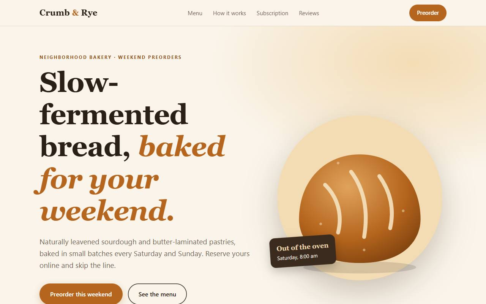
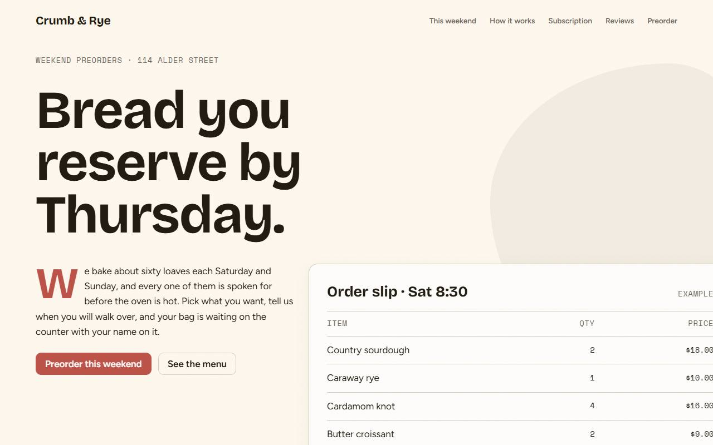
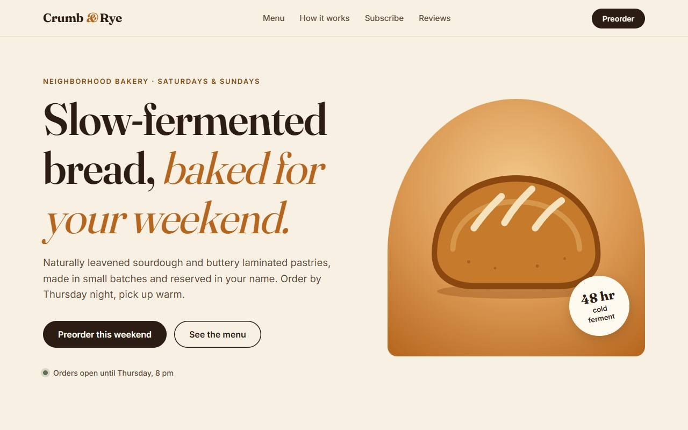
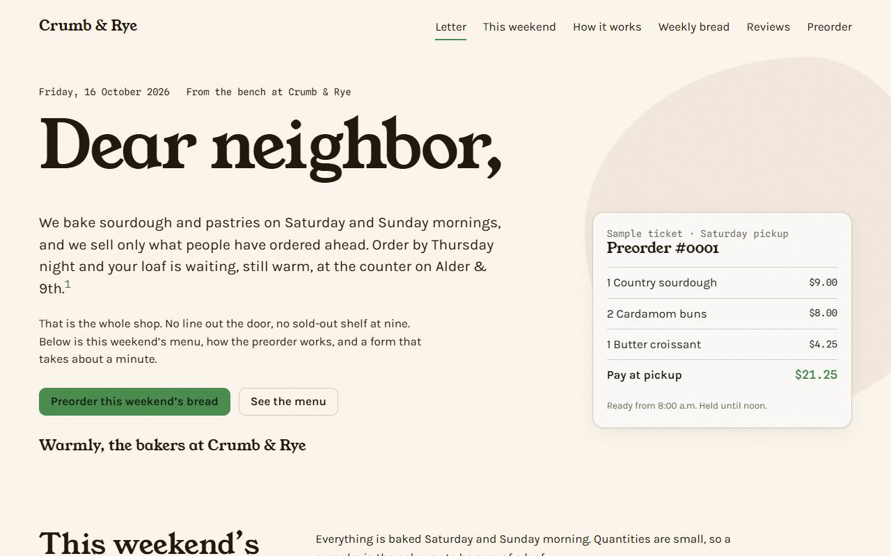
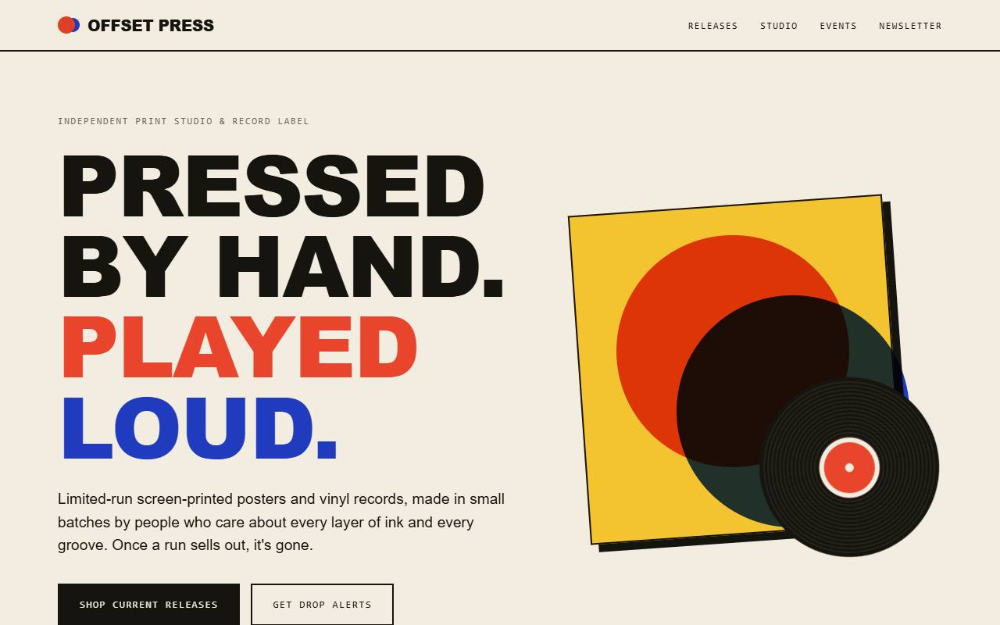
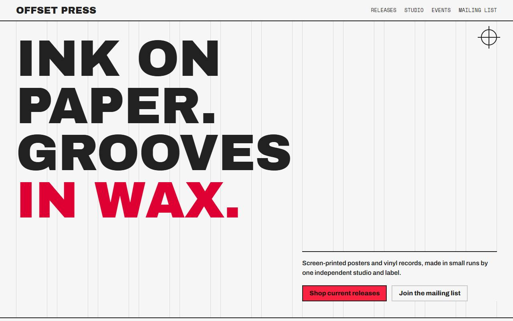
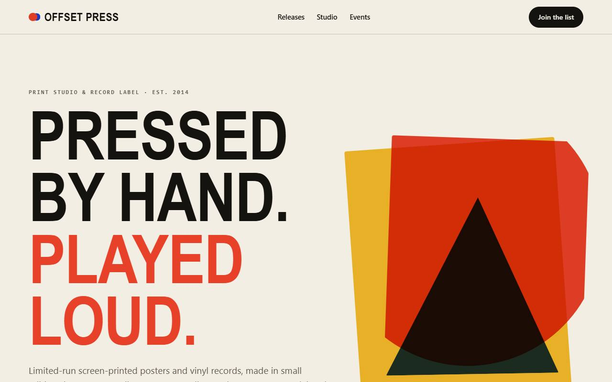
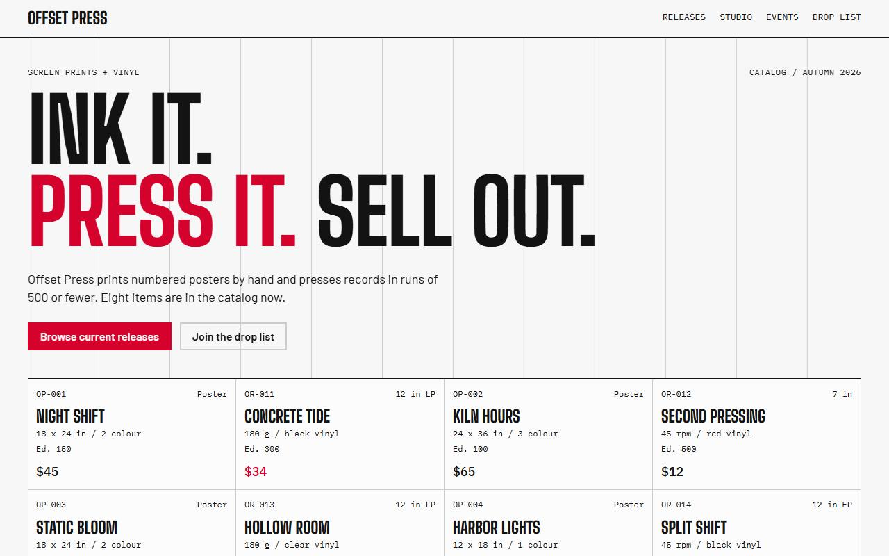
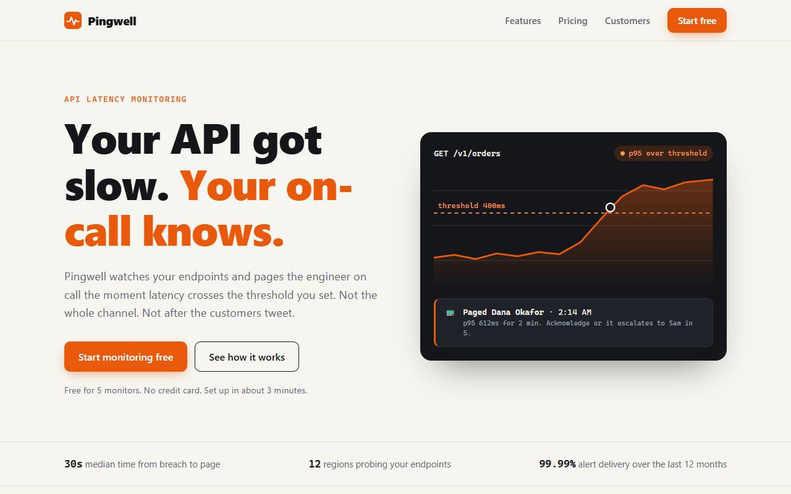
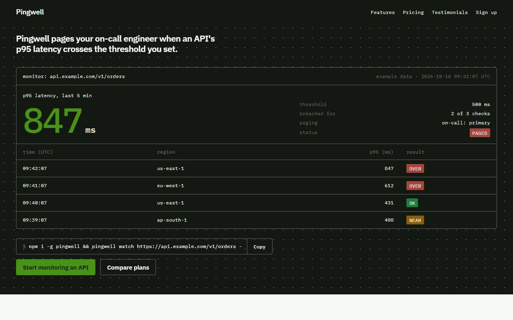

# Benchmark: 2026-10-16

Same prompt, same model, fresh directory per run. `baseline` gets the task only; `sloplint` also gets `sloplint init --brief <the prompt's first sentence>` and a local install; `hooks` is `sloplint` plus `--hooks` (Claude Code only). 12 scored runs, up to 2 per cell. Method and caveats: [bench/README.md](../../README.md).

## Summary

| Agent | Model | Arm | Mean Slop Score | Findings | Errors | Suppressions | Mean time | Mean turns | Mean tokens in/out | Mean cost |
| --- | --- | --- | --- | --- | --- | --- | --- | --- | --- | --- |
| claude | `claude-sonnet-5-5` | baseline | 27.2 | 16 | 1 | 0 | 74s | 2.0 | 111k / 10.1k | $0.304 |
| claude | `claude-sonnet-5-5` | hooks | 0.0 | 0 | 0 | 0 | 98s | 3.3 | 203k / 12.6k | $0.357 |

- **claude hooks** against baseline: the mean score was lower on 3 of 3 tasks, equal on 0 and higher on 0.

## Slop Score by task

Mean score per cell, lower is better; individual runs in brackets.

| Task | claude baseline | claude hooks |
| --- | --- | --- |
| landing-bakery | 34 [37, 31] | 0 [0, 0] |
| landing-print | 17 [25, 8] | 0 [0, 0] |
| landing-uptime | 31 [31, 31] | 0 [0, 0] |

## Checks that do not use sloplint

| Task | Check | claude baseline | claude hooks |
| --- | --- | --- | --- |
| tests | Suite passes | n/a | n/a |
| tests | Mutants killed | n/a | n/a |
| readme | Real flags documented | n/a | n/a |
| readme | Invented flags | n/a | n/a |
| api | Syntax errors | n/a | n/a |
| landing-bakery | Overflows at 375px | no, no | no, yes |
| landing-bakery | Page errors | 0, 0 | 0, 0 |
| landing-print | Overflows at 375px | no, no | no, no |
| landing-print | Page errors | 0, 0 | 0, 0 |
| landing-uptime | Overflows at 375px | no, no | no, no |
| landing-uptime | Page errors | 0, 0 | 0, 0 |
| video | Files present | n/a | n/a |
| dashboard | File present | n/a | n/a |

## Landing page look

Declared headline and body typefaces, and the fill of the first filled link or button (the primary call to action), read from the rendered page. "AI purple" is the saturated indigo-to-violet band of UI-001.

| Task | Agent | Arm | Run | Design system | Headline face | Body face | CTA fill |
| --- | --- | --- | --- | --- | --- | --- | --- |
| landing-bakery | claude | baseline | 1 | none | Georgia | system-ui | `#b5651d` hue 28 |
| landing-bakery | claude | baseline | 2 | none | Fraunces | Inter | `#b5651d` hue 28 |
| landing-bakery | claude | hooks | 1 | Hearth Specimen | Bricolage Grotesque | Space Mono | `#bc5147` hue 5 |
| landing-bakery | claude | hooks | 2 | Kiln Letter | Young Serif | Karla | `#4c8f50` hue 124 |
| landing-print | claude | baseline | 1 | none | Arial Black | ui-monospace | `#16140f` hue 43 |
| landing-print | claude | baseline | 2 | none | Arial Narrow | ui-monospace | `#14130f` hue 48 |
| landing-print | claude | hooks | 1 | Plinth Manifesto | Archivo Black | Archivo | `#f92241` hue 351 |
| landing-print | claude | hooks | 2 | Rebar Catalog | Big Shoulders Display | Barlow | `#d4022d` hue 348 |
| landing-uptime | claude | baseline | 1 | none | Inter | Inter | `#e8590c` hue 21 |
| landing-uptime | claude | baseline | 2 | none | ui-sans-serif | ui-monospace | `#3ddc97` hue 154 |
| landing-uptime | claude | hooks | 1 | Signal Console | n/a | IBM Plex Sans | `#499218` hue 96 |
| landing-uptime | claude | hooks | 2 | Vector Specimen | Chivo | Chivo | `#11c7d3` hue 184 |

- **claude baseline**: 6 distinct headline faces in 6 pages (Georgia, Fraunces, Arial Black, Arial Narrow, Inter, ui-sans-serif); 0 AI-purple calls to action.
- **claude hooks**: 6 distinct headline faces in 6 pages (Bricolage Grotesque, Young Serif, Archivo Black, Big Shoulders Display, no h1, Chivo); 0 AI-purple calls to action.

## Rules hit

Findings per rule across all runs of each arm.

| Rule | claude baseline | claude hooks |
| --- | --- | --- |
| COPY-005 invented-proof | 8 | 0 |
| UI-002 icon-circle-grid | 2 | 0 |
| UI-005 missing-tabular-nums | 5 | 0 |
| UI-010 fake-success | 1 | 0 |

## Landing pages

First viewport at 1280px. Full outputs are under `runs/`.

**landing-bakery, claude, run 1**

| baseline | hooks |
| --- | --- |
|  |  |

**landing-bakery, claude, run 2**

| baseline | hooks |
| --- | --- |
|  |  |

**landing-print, claude, run 1**

| baseline | hooks |
| --- | --- |
|  |  |

**landing-print, claude, run 2**

| baseline | hooks |
| --- | --- |
|  |  |

**landing-uptime, claude, run 1**

| baseline | hooks |
| --- | --- |
|  |  |

**landing-uptime, claude, run 2**

| baseline | hooks |
| --- | --- |
|  |  |

