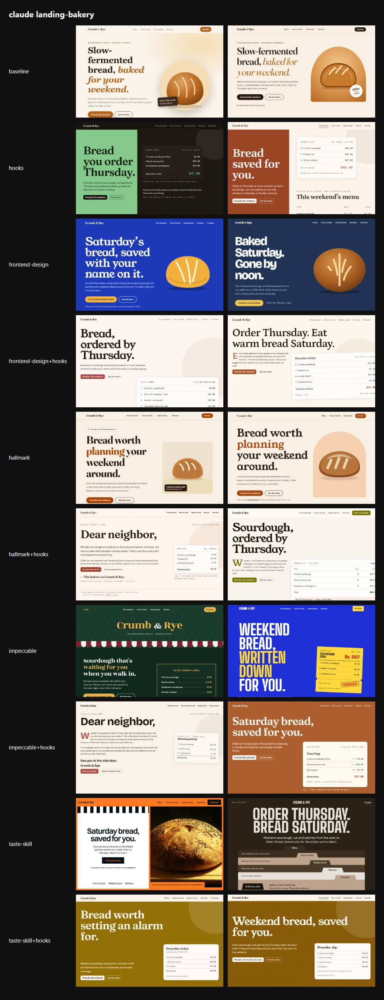
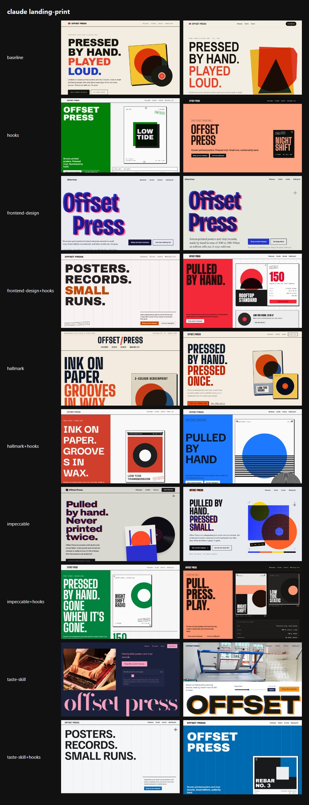
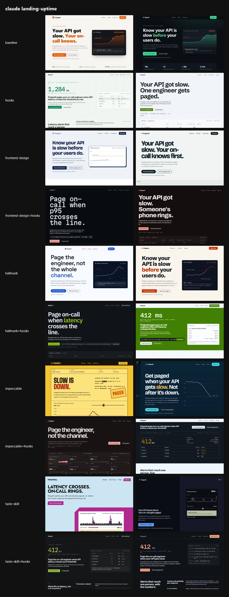

# Benchmark: 2026-10-17

Same prompt, same model, fresh directory per run. `baseline` gets the task only; `sloplint` also gets `sloplint init --brief <the prompt's first sentence>` and a local install; `hooks` is `sloplint` plus `--hooks` (Claude Code only). 60 scored runs, up to 2 per cell. Method and caveats: [bench/README.md](../../README.md).

A skill arm installs that third-party skill at a pinned commit as a project skill (`.claude/skills/<name>/`) with Claude Code's bundled skills turned off, so it is the only skill the agent sees; `<skill>+hooks` adds sloplint's hooks to it. The prompt never names the skill, so the agent loads it or not on its own.

| Skill | Source at the pinned commit | Runs that loaded it | Runs of its scripts per run |
| --- | --- | --- | --- |
| `frontend-design` | [anthropics/skills@dbd4588](https://github.com/anthropics/skills/tree/dbd4588f9e1033efb41dad4bef2f7947c8993d44/skills/frontend-design) | 9 of 12 | 0.0 |
| `hallmark` | [Nutlope/hallmark@13ac0ec](https://github.com/Nutlope/hallmark/tree/13ac0ec7e148655948100b6396439e481361d690/skills/hallmark) | 11 of 12 | 0.0 |
| `impeccable` | [pbakaus/impeccable@6af45ac](https://github.com/pbakaus/impeccable/tree/6af45ac9a5eb8792f033d3242f52e99812fd91fa/.claude/skills/impeccable) | 6 of 12 | 3.0 |
| `design-taste-frontend` | [Leonxlnx/taste-skill@f624f37](https://github.com/Leonxlnx/taste-skill/tree/f624f37a8c650b9cc550253104925efe4c8de246/skills/taste-skill) | 12 of 12 | 6.4 |

## Findings

Claude Sonnet 5.5, three landing-page briefs, two runs per arm. The `baseline` runs are the 2026-10-16 runs (same model, flags and prompts), rescored here; every other arm ran on 2026-10-17. The Slop Score is sloplint's own metric, so the hooks arms scoring 0 is expected. The checks that do not use sloplint, and the screenshots, matter more.

**Where the skills beat sloplint**

- **Pages that fit a phone.** With sloplint's hooks, all six print-studio pages from the frontend-design, hallmark and taste-skill arms overflow at 375px. Each puts the releases or events in a wide table with no narrow-screen layout. The same three skills without sloplint overflowed on none of their print pages (taste-skill alone overflowed on two other pages). sloplint has no check for this, and its DESIGN.md says nothing about tables.
- **Looks.** Our read of the grids: the boldest individual pages come from the skills alone. taste-skill pulls real archive photographs into the print and bakery pages, and impeccable produced the yellow telegram-style uptime page and the blue-and-yellow bakery page. With sloplint, pages converge on the devices its DESIGN.md suggests: four of its uptime pages open on a large "412 ms" figure, every one of its bakery pages shows an order-slip card, and most of its print pages use a split color field with a poster. Counting headline typefaces hides this.
- **Using the skill at all.** Next to sloplint's instructions, the agent often skipped the skill: impeccable was loaded in 0 of 6 runs, frontend-design in 3 of 6, and taste-skill in 6 of 6, but its scripts never ran. "Skill plus sloplint" mostly measures sloplint.

**Where sloplint helps**

- Slop Score 0 in every hooks arm. Alone, the skills scored 9.8 (frontend-design), 17.7 (hallmark), 17.8 (impeccable) and 29.7 (taste-skill), against 27.2 for no skill.
- Fewer invented numbers: 0 to 0.2 per page with hooks, 0.3 to 2.7 for the skills alone and 2.7 with no skill.
- Variety of type: every hooks arm used six headline faces in six pages. frontend-design alone used two (Young Serif and Bricolage Grotesque), and its bakery pages drew the same kind of CSS loaf of bread as the baseline and hallmark.
- Cost: $0.31 to $0.48 per run with hooks, against $0.82 for impeccable and $1.13 for taste-skill alone, which ran for twelve minutes on average.

**Caveats**

- Two runs per cell is enough to see patterns, not to rank arms that are close.
- One model and three landing pages. The skills do more than build landing pages.
- The looks verdict is a judgment call. The screenshots are below so you can make your own.
- impeccable and taste-skill ran their own tools: impeccable's engine 0.1.15 (its sha256 matched the GitHub release) and taste-skill's direction picker, browser inspector and image search. taste-skill's downloaded photos are not republished here because their licenses vary, so its pages under `runs/` show missing images; the screenshots show them as rendered.
- The benchmark cost $28.53, including one impeccable run discarded because of a harness bug (fixed before the full run).

## Summary

| Agent | Model | Arm | Mean Slop Score | Findings | Errors | Suppressions | Mean time | Mean turns | Mean tokens in/out | Mean cost |
| --- | --- | --- | --- | --- | --- | --- | --- | --- | --- | --- |
| claude | `claude-sonnet-5-5` | baseline | 27.2 | 16 | 1 | 0 | 74s | 2.0 | 111k / 10.1k | $0.304 |
| claude | `claude-sonnet-5-5` | hooks | 0.0 | 0 | 0 | 0 | 79s | 3.3 | 173k / 10.6k | $0.307 |
| claude | `claude-sonnet-5-5` | frontend-design | 9.8 | 7 | 0 | 0 | 86s | 4.2 | 164k / 11.8k | $0.322 |
| claude | `claude-sonnet-5-5` | frontend-design+hooks | 0.0 | 0 | 0 | 0 | 87s | 4.2 | 183k / 11.6k | $0.339 |
| claude | `claude-sonnet-5-5` | hallmark | 17.7 | 21 | 2 | 0 | 121s | 9.8 | 604k / 16.3k | $0.517 |
| claude | `claude-sonnet-5-5` | hallmark+hooks | 0.0 | 0 | 0 | 0 | 100s | 7.5 | 467k / 12.3k | $0.478 |
| claude | `claude-sonnet-5-5` | impeccable | 17.8 | 7 | 3 | 0 | 234s | 25.0 | 1543k / 26.9k | $0.819 |
| claude | `claude-sonnet-5-5` | impeccable+hooks | 0.0 | 0 | 0 | 0 | 87s | 3.8 | 226k / 11.6k | $0.326 |
| claude | `claude-sonnet-5-5` | taste-skill | 29.7 | 12 | 6 | 0 | 736s | 24.8 | 2059k / 29.0k | $1.134 |
| claude | `claude-sonnet-5-5` | taste-skill+hooks | 0.0 | 0 | 0 | 0 | 102s | 7.5 | 376k / 12.6k | $0.410 |

- **claude hooks** against baseline: the mean score was lower on 3 of 3 tasks, equal on 0 and higher on 0.
- **claude frontend-design** against baseline: the mean score was lower on 3 of 3 tasks, equal on 0 and higher on 0.
- **claude frontend-design+hooks** against frontend-design: the mean score was lower on 3 of 3 tasks, equal on 0 and higher on 0.
- **claude hallmark** against baseline: the mean score was lower on 2 of 3 tasks, equal on 1 and higher on 0.
- **claude hallmark+hooks** against hallmark: the mean score was lower on 3 of 3 tasks, equal on 0 and higher on 0.
- **claude impeccable** against baseline: the mean score was lower on 2 of 3 tasks, equal on 1 and higher on 0.
- **claude impeccable+hooks** against impeccable: the mean score was lower on 2 of 3 tasks, equal on 1 and higher on 0.
- **claude taste-skill** against baseline: the mean score was lower on 1 of 3 tasks, equal on 0 and higher on 2.
- **claude taste-skill+hooks** against taste-skill: the mean score was lower on 3 of 3 tasks, equal on 0 and higher on 0.

## Slop Score by task

Mean score per cell, lower is better; individual runs in brackets.

| Task | claude baseline | claude hooks | claude frontend-design | claude frontend-design+hooks | claude hallmark | claude hallmark+hooks | claude impeccable | claude impeccable+hooks | claude taste-skill | claude taste-skill+hooks |
| --- | --- | --- | --- | --- | --- | --- | --- | --- | --- | --- |
| landing-bakery | 34 [37, 31] | 0 [0, 0] | 10 [8, 12] | 0 [0, 0] | 34 [34, 34] | 0 [0, 0] | 34 [15, 53] | 0 [0, 0] | 46 [63, 28] | 0 [0, 0] |
| landing-print | 17 [25, 8] | 0 [0, 0] | 8 [8, 8] | 0 [0, 0] | 15 [8, 22] | 0 [0, 0] | 0 [0, 0] | 0 [0, 0] | 4 [8, 0] | 0 [0, 0] |
| landing-uptime | 31 [31, 31] | 0 [0, 0] | 12 [15, 8] | 0 [0, 0] | 4 [0, 8] | 0 [0, 0] | 20 [39, 0] | 0 [0, 0] | 40 [57, 22] | 0 [0, 0] |

## Checks that do not use sloplint

| Task | Check | claude baseline | claude hooks | claude frontend-design | claude frontend-design+hooks | claude hallmark | claude hallmark+hooks | claude impeccable | claude impeccable+hooks | claude taste-skill | claude taste-skill+hooks |
| --- | --- | --- | --- | --- | --- | --- | --- | --- | --- | --- | --- |
| tests | Suite passes | n/a | n/a | n/a | n/a | n/a | n/a | n/a | n/a | n/a | n/a |
| tests | Mutants killed | n/a | n/a | n/a | n/a | n/a | n/a | n/a | n/a | n/a | n/a |
| readme | Real flags documented | n/a | n/a | n/a | n/a | n/a | n/a | n/a | n/a | n/a | n/a |
| readme | Invented flags | n/a | n/a | n/a | n/a | n/a | n/a | n/a | n/a | n/a | n/a |
| api | Syntax errors | n/a | n/a | n/a | n/a | n/a | n/a | n/a | n/a | n/a | n/a |
| landing-bakery | Overflows at 375px | no, no | no, no | no, no | no, no | no, no | no, no | no, no | no, no | yes, no | no, no |
| landing-bakery | Page errors | 0, 0 | 0, 0 | 0, 0 | 0, 0 | 0, 0 | 0, 0 | 0, 0 | 0, 0 | 0, 0 | 0, 0 |
| landing-bakery | Invented numeric claims | 3, 6 | 0, 0 | 1, 1 | 0, 0 | 8, 0 | 0, 0 | 0, 8 | 0, 0 | 10, 3 | 0, 0 |
| landing-print | Overflows at 375px | no, no | no, no | no, no | yes, yes | no, no | yes, yes | no, no | no, no | no, no | yes, yes |
| landing-print | Page errors | 0, 0 | 0, 0 | 0, 0 | 0, 0 | 0, 0 | 0, 0 | 0, 0 | 0, 0 | 0, 0 | 0, 0 |
| landing-print | Invented numeric claims | 1, 2 | 0, 0 | 0, 0 | 0, 0 | 1, 0 | 1, 0 | 0, 0 | 0, 0 | 0, 0 | 0, 0 |
| landing-uptime | Overflows at 375px | no, no | no, no | no, no | no, no | no, no | no, no | no, no | no, no | yes, no | no, no |
| landing-uptime | Page errors | 0, 0 | 0, 0 | 0, 0 | 0, 0 | 0, 0 | 0, 0 | 0, 0 | 0, 0 | 0, 0 | 0, 0 |
| landing-uptime | Invented numeric claims | 2, 2 | 1, 0 | 0, 0 | 1, 0 | 1, 0 | 0, 0 | 0, 0 | 0, 0 | 3, 0 | 0, 0 |
| video | Files present | n/a | n/a | n/a | n/a | n/a | n/a | n/a | n/a | n/a | n/a |
| dashboard | File present | n/a | n/a | n/a | n/a | n/a | n/a | n/a | n/a | n/a | n/a |

## Landing page look

Declared headline and body typefaces, and the fill of the first filled link or button (the primary call to action), read from the rendered page. "AI purple" is the saturated indigo-to-violet band of UI-001.

| Task | Agent | Arm | Run | Design system | Headline face | Body face | CTA fill | Remote hosts |
| --- | --- | --- | --- | --- | --- | --- | --- | --- |
| landing-bakery | claude | baseline | 1 | none | Georgia | system-ui | `#b5651d` orange | none |
| landing-bakery | claude | baseline | 2 | none | Fraunces | Inter | `#b5651d` orange | fonts.googleapis.com, fonts.gstatic.com |
| landing-bakery | claude | hooks | 1 | Kiln Split | Fraunces | Commissioner | `#85ca8c` green | fonts.googleapis.com, fonts.gstatic.com |
| landing-bakery | claude | hooks | 2 | Hearth Split | Gelasio | Albert Sans | `#994322` orange | fonts.googleapis.com, fonts.gstatic.com |
| landing-bakery | claude | frontend-design | 1 | none | Young Serif | Instrument Sans | `#f2b13c` orange | fonts.googleapis.com, fonts.gstatic.com |
| landing-bakery | claude | frontend-design | 2 | none | Bricolage Grotesque | Newsreader | `#f1c453` orange | fonts.googleapis.com, fonts.gstatic.com |
| landing-bakery | claude | frontend-design+hooks | 1 | Loam Specimen | Young Serif | Karla | `#a84748` red | fonts.googleapis.com, fonts.gstatic.com |
| landing-bakery | claude | frontend-design+hooks | 2 | Hearth Specimen | Petrona | Hanken Grotesk | `#aa5121` orange | fonts.googleapis.com, fonts.gstatic.com |
| landing-bakery | claude | hallmark | 1 | none | Fraunces | Instrument Sans | `#ab4400` orange | fonts.googleapis.com, fonts.gstatic.com |
| landing-bakery | claude | hallmark | 2 | none | Young Serif | Figtree | `#a84811` orange | fonts.googleapis.com, fonts.gstatic.com |
| landing-bakery | claude | hallmark+hooks | 1 | Kiln Letter | Fraunces | Commissioner | `#9c3e2c` red | fonts.googleapis.com, fonts.gstatic.com |
| landing-bakery | claude | hallmark+hooks | 2 | Loam Specimen | Young Serif | Karla | `#787505` yellow | fonts.googleapis.com, fonts.gstatic.com |
| landing-bakery | claude | impeccable | 1 | none | Rozha One | Hanken Grotesk | `#e6b34c` orange | fonts.googleapis.com, fonts.gstatic.com |
| landing-bakery | claude | impeccable | 2 | none | Big Shoulders Display | Hanken Grotesk | `#ffd93d` yellow | fonts.googleapis.com, fonts.gstatic.com |
| landing-bakery | claude | impeccable+hooks | 1 | Larder Letter | Bricolage Grotesque | Figtree | `#ae4c43` red | fonts.googleapis.com, fonts.gstatic.com |
| landing-bakery | claude | impeccable+hooks | 2 | Larder Specimen | Fraunces | Commissioner | `#ac5f2b` orange | fonts.googleapis.com, fonts.gstatic.com |
| landing-bakery | claude | taste-skill | 1 | none | Switzer | Switzer | `#ff7a1f` orange | api.fontshare.com, cdn.fontshare.com |
| landing-bakery | claude | taste-skill | 2 | none | Big Shoulders | Public Sans | `#382d1e` orange | fonts.googleapis.com, fonts.gstatic.com |
| landing-bakery | claude | taste-skill+hooks | 1 | Loam Poster | Fraunces | Commissioner | `#916e00` yellow | fonts.googleapis.com, fonts.gstatic.com |
| landing-bakery | claude | taste-skill+hooks | 2 | Kiln Poster | Young Serif | Karla | `#fef5ed` neutral | fonts.googleapis.com, fonts.gstatic.com |
| landing-print | claude | baseline | 1 | none | Arial Black | ui-monospace | `#16140f` neutral | none |
| landing-print | claude | baseline | 2 | none | Arial Narrow | ui-monospace | `#14130f` neutral | none |
| landing-print | claude | hooks | 1 | Stencil Split | Archivo Black | Archivo | `#028108` green | fonts.googleapis.com, fonts.gstatic.com |
| landing-print | claude | hooks | 2 | Concrete Poster | Big Shoulders Display | IBM Plex Mono | `#fea382` orange | fonts.googleapis.com, fonts.gstatic.com |
| landing-print | claude | frontend-design | 1 | none | Bricolage Grotesque | Literata | `#16143a` blue | fonts.googleapis.com, fonts.gstatic.com |
| landing-print | claude | frontend-design | 2 | none | Bricolage Grotesque | Newsreader | `#2538c8` blue | fonts.googleapis.com, fonts.gstatic.com |
| landing-print | claude | frontend-design+hooks | 1 | Concrete Manifesto | Archivo Black | Archivo | `#c64902` orange | fonts.googleapis.com, fonts.gstatic.com |
| landing-print | claude | frontend-design+hooks | 2 | Concrete Split | Anton | Inter Tight | `#f32839` red | fonts.googleapis.com, fonts.gstatic.com |
| landing-print | claude | hallmark | 1 | none | Big Shoulders Display | Newsreader | `#e5481e` red | fonts.googleapis.com, fonts.gstatic.com |
| landing-print | claude | hallmark | 2 | none | Big Shoulders Display | Newsreader | `#e84e10` orange | fonts.googleapis.com, fonts.gstatic.com |
| landing-print | claude | hallmark+hooks | 1 | Bulletin Split | Darker Grotesque | Space Mono | `#d03e2c` red | fonts.googleapis.com, fonts.gstatic.com |
| landing-print | claude | hallmark+hooks | 2 | Stencil Split | Familjen Grotesk | Familjen Grotesk | `#1d79fe` azure | fonts.googleapis.com, fonts.gstatic.com |
| landing-print | claude | impeccable | 1 | none | Archivo | Archivo | `#15141a` neutral | fonts.googleapis.com, fonts.gstatic.com |
| landing-print | claude | impeccable | 2 | none | Big Shoulders Display | Hanken Grotesk | `#ffd60a` yellow | fonts.googleapis.com, fonts.gstatic.com |
| landing-print | claude | impeccable+hooks | 1 | Rebar Split | Big Shoulders Display | Barlow | `#f5f6f5` neutral | fonts.googleapis.com, fonts.gstatic.com |
| landing-print | claude | impeccable+hooks | 2 | Stencil Split | Anton | Inter Tight | `#fe9773` orange | fonts.googleapis.com, fonts.gstatic.com |
| landing-print | claude | taste-skill | 1 | none | Bodoni Moda | Jost | `#f9a3c0` rose | fonts.googleapis.com, fonts.gstatic.com |
| landing-print | claude | taste-skill | 2 | none | Onest | Onest | `#1f2b4d` azure | fonts.googleapis.com, fonts.gstatic.com |
| landing-print | claude | taste-skill+hooks | 1 | Rebar Manifesto | Familjen Grotesk | Familjen Grotesk | `#006ac9` azure | fonts.googleapis.com, fonts.gstatic.com |
| landing-print | claude | taste-skill+hooks | 2 | Rebar Poster | Archivo Black | Archivo | `#006ab0` azure | fonts.googleapis.com, fonts.gstatic.com |
| landing-uptime | claude | baseline | 1 | none | Inter | Inter | `#e8590c` orange | none |
| landing-uptime | claude | baseline | 2 | none | ui-sans-serif | ui-monospace | `#3ddc97` teal | none |
| landing-uptime | claude | hooks | 1 | Kernel Ledger | IBM Plex Sans | IBM Plex Mono | `#077c51` teal | fonts.googleapis.com, fonts.gstatic.com |
| landing-uptime | claude | hooks | 2 | Relay Specimen | Schibsted Grotesk | Schibsted Grotesk | `#4d7b01` lime | fonts.googleapis.com, fonts.gstatic.com |
| landing-uptime | claude | frontend-design | 1 | none | Bricolage Grotesque | Instrument Sans | `#11224a` azure | fonts.googleapis.com, fonts.gstatic.com |
| landing-uptime | claude | frontend-design | 2 | none | Bricolage Grotesque | Instrument Sans | `#0f2229` neutral | fonts.googleapis.com, fonts.gstatic.com |
| landing-uptime | claude | frontend-design+hooks | 1 | Circuit Specimen | Martian Mono | Hanken Grotesk | `#fea4a1` red | fonts.googleapis.com, fonts.gstatic.com |
| landing-uptime | claude | frontend-design+hooks | 2 | Relay Specimen | Archivo | Archivo | `#ffa293` red | fonts.googleapis.com, fonts.gstatic.com |
| landing-uptime | claude | hallmark | 1 | none | Space Grotesk | Space Grotesk | `#1f57d3` azure | fonts.googleapis.com, fonts.gstatic.com |
| landing-uptime | claude | hallmark | 2 | none | Schibsted Grotesk | Schibsted Grotesk | `#cb3000` red | fonts.googleapis.com, fonts.gstatic.com |
| landing-uptime | claude | hallmark+hooks | 1 | Circuit Specimen | IBM Plex Sans | IBM Plex Sans | `#92c016` lime | fonts.googleapis.com, fonts.gstatic.com |
| landing-uptime | claude | hallmark+hooks | 2 | Relay Ledger | Archivo | Azeret Mono | `#428001` lime | fonts.googleapis.com, fonts.gstatic.com |
| landing-uptime | claude | impeccable | 1 | none | Big Shoulders Display | Archivo | `#f4c430` yellow | fonts.googleapis.com, fonts.gstatic.com |
| landing-uptime | claude | impeccable | 2 | none | Bricolage Grotesque | Hanken Grotesk | `#46d9e3` cyan | fonts.googleapis.com, fonts.gstatic.com |
| landing-uptime | claude | impeccable+hooks | 1 | Vector Catalog | Inter Tight | Inter Tight | `#feafa6` red | fonts.googleapis.com, fonts.gstatic.com |
| landing-uptime | claude | impeccable+hooks | 2 | Kernel Console | Chivo | Chivo | `#ac740c` orange | fonts.googleapis.com, fonts.gstatic.com |
| landing-uptime | claude | taste-skill | 1 | none | Jost | Jost | `#b0298f` magenta, AI purple | fonts.googleapis.com, fonts.gstatic.com |
| landing-uptime | claude | taste-skill | 2 | none | Switzer | Switzer | `#5a9bfc` azure | api.fontshare.com, cdn.fontshare.com |
| landing-uptime | claude | taste-skill+hooks | 1 | Signal Ledger | Inter Tight | JetBrains Mono | `#a0c44e` lime | fonts.googleapis.com, fonts.gstatic.com |
| landing-uptime | claude | taste-skill+hooks | 2 | Signal Ledger | Chivo | Chivo Mono | `#feae84` orange | fonts.googleapis.com, fonts.gstatic.com |

Distinctiveness across each arm's pages: distinct headline faces and distinct CTA hue families (twelve 30° families; "neutral" when the first filled button is gray, black or white). More is more varied; the three briefs ask for three different businesses.

| Agent | Arm | Pages | Headline faces | CTA hue families | AI-purple CTAs | Overflow at 375px | Mean invented claims |
| --- | --- | --- | --- | --- | --- | --- | --- |
| claude | baseline | 6 | 6: Georgia, Fraunces, Arial Black, Arial Narrow, Inter, ui-sans-serif | 3: orange, neutral, teal | 0 | 0 | 2.7 |
| claude | hooks | 6 | 6: Fraunces, Gelasio, Archivo Black, Big Shoulders Display, IBM Plex Sans, Schibsted Grotesk | 4: green, orange, teal, lime | 0 | 0 | 0.2 |
| claude | frontend-design | 6 | 2: Young Serif, Bricolage Grotesque | 4: orange, blue, azure, neutral | 0 | 0 | 0.3 |
| claude | frontend-design+hooks | 6 | 6: Young Serif, Petrona, Archivo Black, Anton, Martian Mono, Archivo | 2: red, orange | 0 | 2 | 0.2 |
| claude | hallmark | 6 | 5: Fraunces, Young Serif, Big Shoulders Display, Space Grotesk, Schibsted Grotesk | 3: orange, red, azure | 0 | 0 | 1.7 |
| claude | hallmark+hooks | 6 | 6: Fraunces, Young Serif, Darker Grotesque, Familjen Grotesk, IBM Plex Sans, Archivo | 4: red, yellow, azure, lime | 0 | 2 | 0.2 |
| claude | impeccable | 6 | 4: Rozha One, Big Shoulders Display, Archivo, Bricolage Grotesque | 4: orange, yellow, neutral, cyan | 0 | 0 | 1.3 |
| claude | impeccable+hooks | 6 | 6: Bricolage Grotesque, Fraunces, Big Shoulders Display, Anton, Inter Tight, Chivo | 3: red, orange, neutral | 0 | 0 | 0.0 |
| claude | taste-skill | 6 | 5: Switzer, Big Shoulders, Bodoni Moda, Onest, Jost | 4: orange, rose, azure, magenta | 1 | 2 | 2.7 |
| claude | taste-skill+hooks | 6 | 6: Fraunces, Young Serif, Familjen Grotesk, Archivo Black, Inter Tight, Chivo | 5: yellow, neutral, azure, lime, orange | 0 | 2 | 0.0 |

## Rules hit

Findings per rule across all runs of each arm.

| Rule | claude baseline | claude hooks | claude frontend-design | claude frontend-design+hooks | claude hallmark | claude hallmark+hooks | claude impeccable | claude impeccable+hooks | claude taste-skill | claude taste-skill+hooks |
| --- | --- | --- | --- | --- | --- | --- | --- | --- | --- | --- |
| COPY-003 vague-label | 0 | 0 | 0 | 0 | 0 | 0 | 0 | 0 | 1 | 0 |
| COPY-004 placeholder-content | 0 | 0 | 0 | 0 | 0 | 0 | 1 | 0 | 2 | 0 |
| COPY-005 invented-proof | 8 | 0 | 0 | 0 | 0 | 0 | 0 | 0 | 0 | 0 |
| SEC-007 unsanitized-html | 0 | 0 | 0 | 0 | 2 | 0 | 3 | 0 | 6 | 0 |
| UI-002 icon-circle-grid | 2 | 0 | 0 | 0 | 0 | 0 | 1 | 0 | 0 | 0 |
| UI-005 missing-tabular-nums | 5 | 0 | 5 | 0 | 4 | 0 | 2 | 0 | 1 | 0 |
| UI-006 nonconcentric-radius | 0 | 0 | 1 | 0 | 0 | 0 | 0 | 0 | 0 | 0 |
| UI-010 fake-success | 1 | 0 | 0 | 0 | 0 | 0 | 0 | 0 | 0 | 0 |
| UI-013 dead-link | 0 | 0 | 0 | 0 | 15 | 0 | 0 | 0 | 2 | 0 |
| UI-014 grid-too-wide | 0 | 0 | 1 | 0 | 0 | 0 | 0 | 0 | 0 | 0 |

## Landing pages

First viewport at 1280px, one column per run; 375px shots are in `shots/` and full outputs under `runs/`.

**landing-bakery, claude, every arm**

**landing-print, claude, every arm**

**landing-uptime, claude, every arm**

Per arm, every task: [baseline](grids/claude-baseline.jpg), [hooks](grids/claude-hooks.jpg), [frontend-design](grids/claude-frontend-design.jpg), [frontend-design+hooks](grids/claude-frontend-design+hooks.jpg), [hallmark](grids/claude-hallmark.jpg), [hallmark+hooks](grids/claude-hallmark+hooks.jpg), [impeccable](grids/claude-impeccable.jpg), [impeccable+hooks](grids/claude-impeccable+hooks.jpg), [taste-skill](grids/claude-taste-skill.jpg), [taste-skill+hooks](grids/claude-taste-skill+hooks.jpg).
