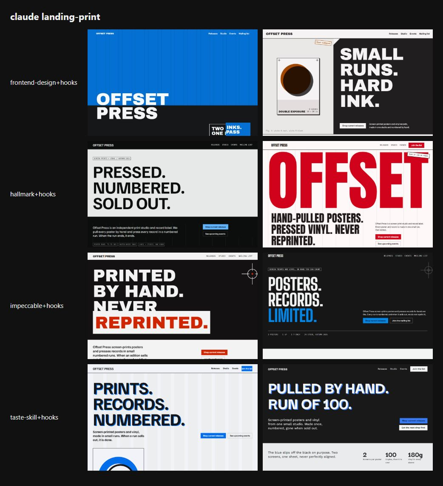
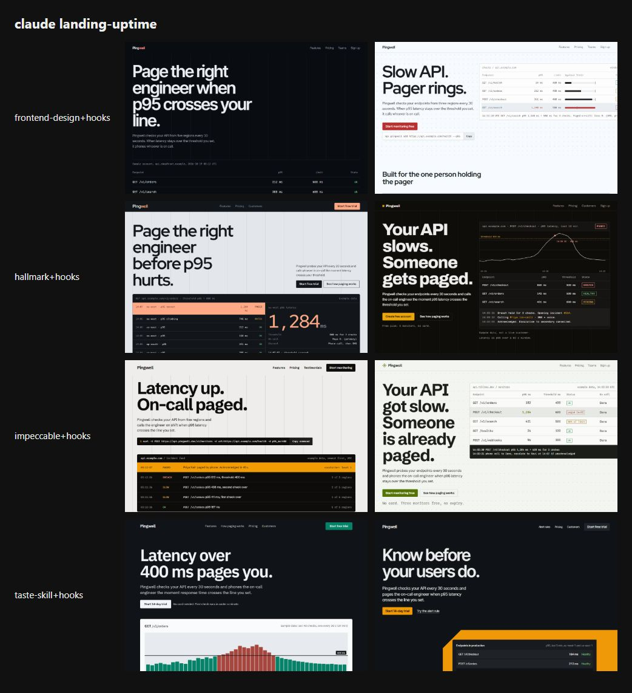

# Benchmark: 2026-10-19

Same prompt, same model, fresh directory per run. `baseline` gets the task only; `sloplint` also gets `sloplint init --brief <the prompt's first sentence>` and a local install; `hooks` is `sloplint` plus `--hooks` (Claude Code only). 16 scored runs, up to 2 per cell. Method and caveats: [bench/README.md](../../README.md).

A skill arm installs that third-party skill at a pinned commit as a project skill (`.claude/skills/<name>/`) with Claude Code's bundled skills turned off, so it is the only skill the agent sees; `<skill>+hooks` adds sloplint's hooks to it. The prompt never names the skill, so the agent loads it or not on its own.

| Skill | Source at the pinned commit | Runs that loaded it | Runs of its scripts per run |
| --- | --- | --- | --- |
| `frontend-design` | [anthropics/skills@dbd4588](https://github.com/anthropics/skills/tree/dbd4588f9e1033efb41dad4bef2f7947c8993d44/skills/frontend-design) | 4 of 4 | 0.0 |
| `hallmark` | [Nutlope/hallmark@13ac0ec](https://github.com/Nutlope/hallmark/tree/13ac0ec7e148655948100b6396439e481361d690/skills/hallmark) | 4 of 4 | 0.0 |
| `impeccable` | [pbakaus/impeccable@6af45ac](https://github.com/pbakaus/impeccable/tree/6af45ac9a5eb8792f033d3242f52e99812fd91fa/.claude/skills/impeccable) | 4 of 4 | 1.0 |
| `design-taste-frontend` | [Leonxlnx/taste-skill@f624f37](https://github.com/Leonxlnx/taste-skill/tree/f624f37a8c650b9cc550253104925efe4c8de246/skills/taste-skill) | 4 of 4 | 5.0 |

## Findings

The 2026-10-17 head-to-head found three losses for sloplint's hooks. This re-run checks the 0.3.0 fixes on the two briefs where they showed: the four `<skill>+hooks` arms on the print and uptime briefs, two runs each. Claude Sonnet 5.5, with the same flags and prompts as 2026-10-17. 16 runs cost $7.66.

| Gate | 2026-10-17 (same arms and briefs) | 2026-10-19 | Result |
| --- | --- | --- | --- |
| Pages that overflow at 375px | 6 of 16 (6 of 8 print) | 0 of 16 | pass |
| Runs that loaded the arm's skill | 8 of 16 (impeccable 0 of 4, frontend-design 1 of 4) | 16 of 16 (each arm 4 of 4) | pass |
| Distinct first-screen devices, print / uptime | 3 / 4 | 4 / 3 | not clearly up |

- **Overflow.** Every page that overflowed on 2026-10-17 already had an `overflow-x: auto` table wrapper. The cause was a visually hidden "Order" label (`position: absolute`) in the last header cell. The wrapper was not positioned, so it could not clip the label, which widened the page to between 442 and 590px. `UI-015` now flags this, and the DESIGN.md line on tables at narrow widths says to make the wrapper `position: relative`. No page overflowed this time.
- **Skills.** The rule block and DESIGN.md now tell the agent to let another design skill lead, and every run loaded its skill. impeccable ran its engine once per run (0 times on 2026-10-17), and taste-skill ran its scripts five times per run (0).
- **First screens.** The named devices no longer repeat. No uptime page opens on a large "412 ms" figure (4 of 8 on 2026-10-17), and only one print page uses the split color field with a poster (5 of 8). But the variety did not clearly grow:
  - All eight uptime pages lead with the headline over the product: an endpoint table (4), an incident feed (2) or a latency chart (2).
  - Five of the eight print systems drew the Manifesto layout, and five print pages open on a stacked typographic statement.
  - The more unusual forms on offer were never picked, such as the product in fanned states or the product shown twice.

The device counts are our own classification of the first-viewport shots below:

| Brief | 2026-10-17 (four +hooks arms, 8 pages) | 2026-10-19 (8 pages) |
| --- | --- | --- |
| landing-print | split color field with a poster 5, typographic statement 2, full-bleed color field 1 | typographic statement 5, full-bleed color field 1, split color field with a poster 1, one word cropped at both edges 1 |
| landing-uptime | oversized figure 4, typographic statement 2, headline over a product table 1, headline over metric tiles 1 | headline over an endpoint table 4, over an incident feed 2, over a latency chart 2 |

The generator was tuned after this run, and the first screens were measured again in [2026-10-20-rebench](../2026-10-20-rebench/README.md).

**Caveats.** The sample is two runs per cell, two briefs and one model. The device classes are a judgment call; the screenshots are below.

## Summary

| Agent | Model | Arm | Mean Slop Score | Findings | Errors | Suppressions | Mean time | Mean turns | Mean tokens in/out | Mean cost |
| --- | --- | --- | --- | --- | --- | --- | --- | --- | --- | --- |
| claude | `claude-sonnet-5-5` | frontend-design+hooks | 0.0 | 0 | 0 | 0 | 93s | 6.5 | 281k / 11.3k | $0.351 |
| claude | `claude-sonnet-5-5` | hallmark+hooks | 0.0 | 0 | 0 | 0 | 112s | 7.0 | 416k / 14.1k | $0.501 |
| claude | `claude-sonnet-5-5` | impeccable+hooks | 0.0 | 0 | 0 | 0 | 109s | 8.0 | 410k / 12.5k | $0.425 |
| claude | `claude-sonnet-5-5` | taste-skill+hooks | 0.0 | 0 | 0 | 0 | 475s | 11.0 | 757k / 13.5k | $0.638 |

- **claude frontend-design+hooks** against frontend-design: the mean score was lower on 0 of 0 tasks, equal on 0 and higher on 0.
- **claude hallmark+hooks** against hallmark: the mean score was lower on 0 of 0 tasks, equal on 0 and higher on 0.
- **claude impeccable+hooks** against impeccable: the mean score was lower on 0 of 0 tasks, equal on 0 and higher on 0.
- **claude taste-skill+hooks** against taste-skill: the mean score was lower on 0 of 0 tasks, equal on 0 and higher on 0.

## Slop Score by task

Mean score per cell, lower is better; individual runs in brackets.

| Task | claude frontend-design+hooks | claude hallmark+hooks | claude impeccable+hooks | claude taste-skill+hooks |
| --- | --- | --- | --- | --- |
| landing-print | 0 [0, 0] | 0 [0, 0] | 0 [0, 0] | 0 [0, 0] |
| landing-uptime | 0 [0, 0] | 0 [0, 0] | 0 [0, 0] | 0 [0, 0] |

## Checks that do not use sloplint

| Task | Check | claude frontend-design+hooks | claude hallmark+hooks | claude impeccable+hooks | claude taste-skill+hooks |
| --- | --- | --- | --- | --- | --- |
| tests | Suite passes | n/a | n/a | n/a | n/a |
| tests | Mutants killed | n/a | n/a | n/a | n/a |
| readme | Real flags documented | n/a | n/a | n/a | n/a |
| readme | Invented flags | n/a | n/a | n/a | n/a |
| api | Syntax errors | n/a | n/a | n/a | n/a |
| landing-print | Overflows at 375px | no, no | no, no | no, no | no, no |
| landing-print | Page errors | 0, 0 | 0, 0 | 0, 0 | 0, 0 |
| landing-print | Invented numeric claims | 0, 0 | 0, 0 | 0, 0 | 0, 0 |
| landing-uptime | Overflows at 375px | no, no | no, no | no, no | no, no |
| landing-uptime | Page errors | 0, 0 | 0, 0 | 0, 0 | 0, 0 |
| landing-uptime | Invented numeric claims | 0, 0 | 0, 0 | 0, 1 | 0, 0 |
| video | Files present | n/a | n/a | n/a | n/a |
| dashboard | File present | n/a | n/a | n/a | n/a |

## Landing page look

Declared headline and body typefaces, and the fill of the first filled link or button (the primary call to action), read from the rendered page. "AI purple" is the saturated indigo-to-violet band of UI-001.

| Task | Agent | Arm | Run | Design system | Headline face | Body face | CTA fill | Remote hosts |
| --- | --- | --- | --- | --- | --- | --- | --- | --- |
| landing-print | claude | frontend-design+hooks | 1 | Slab Poster | Archivo Black | Archivo | `#0470d2` azure | fonts.googleapis.com, fonts.gstatic.com |
| landing-print | claude | frontend-design+hooks | 2 | Plinth Split | Archivo Black | Archivo | `#a94c03` orange | fonts.googleapis.com, fonts.gstatic.com |
| landing-print | claude | hallmark+hooks | 1 | Stencil Manifesto | Familjen Grotesk | Familjen Grotesk | `#61b4ff` azure | fonts.googleapis.com, fonts.gstatic.com |
| landing-print | claude | hallmark+hooks | 2 | Slab Manifesto | Anton | Inter Tight | `#d0031a` red | fonts.googleapis.com, fonts.gstatic.com |
| landing-print | claude | impeccable+hooks | 1 | Concrete Manifesto | Archivo Black | Archivo | `#d02501` red | fonts.googleapis.com, fonts.gstatic.com |
| landing-print | claude | impeccable+hooks | 2 | Slab Manifesto | Big Shoulders Display | Barlow | `#0684e1` azure | fonts.googleapis.com, fonts.gstatic.com |
| landing-print | claude | taste-skill+hooks | 1 | Concrete Catalog | Familjen Grotesk | Familjen Grotesk | `#006eeb` azure | fonts.googleapis.com, fonts.gstatic.com |
| landing-print | claude | taste-skill+hooks | 2 | Plinth Manifesto | Darker Grotesque | Work Sans | `#377bf6` azure | fonts.googleapis.com, fonts.gstatic.com |
| landing-uptime | claude | frontend-design+hooks | 1 | Relay Ledger | Inter Tight | Inter Tight | `#ff8d8c` red | fonts.googleapis.com, fonts.gstatic.com |
| landing-uptime | claude | frontend-design+hooks | 2 | Telemetry Specimen | Red Hat Display | Red Hat Text | `#b73133` red | fonts.googleapis.com, fonts.gstatic.com |
| landing-uptime | claude | hallmark+hooks | 1 | Vector Console | Red Hat Display | Red Hat Text | `#ffa986` orange | fonts.googleapis.com, fonts.gstatic.com |
| landing-uptime | claude | hallmark+hooks | 2 | Relay Specimen | Archivo | Archivo | `#eaa509` orange | fonts.googleapis.com, fonts.gstatic.com |
| landing-uptime | claude | impeccable+hooks | 1 | Telemetry Console | Schibsted Grotesk | Schibsted Grotesk | `#f39b02` orange | fonts.googleapis.com, fonts.gstatic.com |
| landing-uptime | claude | impeccable+hooks | 2 | Signal Specimen | Schibsted Grotesk | Schibsted Grotesk | `#537304` lime | fonts.googleapis.com, fonts.gstatic.com |
| landing-uptime | claude | taste-skill+hooks | 1 | Kernel Console | IBM Plex Sans | IBM Plex Sans | `#068268` cyan | fonts.googleapis.com, fonts.gstatic.com |
| landing-uptime | claude | taste-skill+hooks | 2 | Telemetry Specimen | Inter Tight | Inter Tight | `#ef9907` orange | fonts.googleapis.com, fonts.gstatic.com |

Distinctiveness across each arm's pages: distinct headline faces and distinct CTA hue families (twelve 30° families; "neutral" when the first filled button is gray, black or white). More is more varied; the three briefs ask for three different businesses.

| Agent | Arm | Pages | Headline faces | CTA hue families | AI-purple CTAs | Overflow at 375px | Mean invented claims |
| --- | --- | --- | --- | --- | --- | --- | --- |
| claude | frontend-design+hooks | 4 | 3: Archivo Black, Inter Tight, Red Hat Display | 3: azure, orange, red | 0 | 0 | 0.0 |
| claude | hallmark+hooks | 4 | 4: Familjen Grotesk, Anton, Red Hat Display, Archivo | 3: azure, red, orange | 0 | 0 | 0.0 |
| claude | impeccable+hooks | 4 | 3: Archivo Black, Big Shoulders Display, Schibsted Grotesk | 4: red, azure, orange, lime | 0 | 0 | 0.3 |
| claude | taste-skill+hooks | 4 | 4: Familjen Grotesk, Darker Grotesque, IBM Plex Sans, Inter Tight | 3: azure, cyan, orange | 0 | 0 | 0.0 |

## Rules hit

Findings per rule across all runs of each arm.

| Rule | claude frontend-design+hooks | claude hallmark+hooks | claude impeccable+hooks | claude taste-skill+hooks |
| --- | --- | --- | --- | --- |

## Landing pages

First viewport at 1280px, one column per run; 375px shots are in `shots/` and full outputs under `runs/`.

**landing-print, claude, every arm**

**landing-uptime, claude, every arm**

Per arm, every task: [frontend-design+hooks](grids/claude-frontend-design+hooks.jpg), [hallmark+hooks](grids/claude-hallmark+hooks.jpg), [impeccable+hooks](grids/claude-impeccable+hooks.jpg), [taste-skill+hooks](grids/claude-taste-skill+hooks.jpg).
