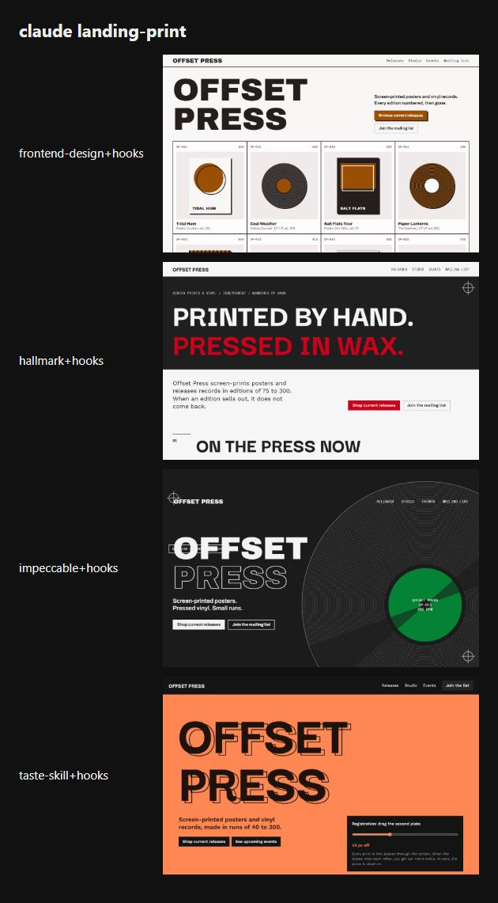
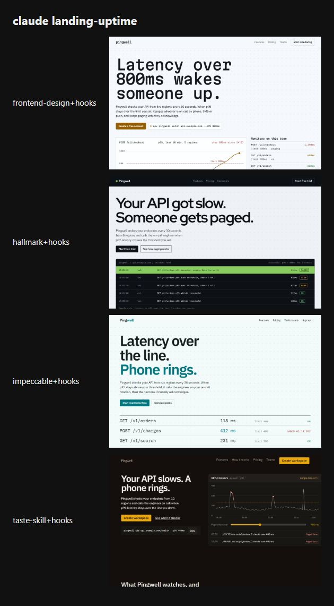

# Benchmark: 2026-10-19

Same prompt, same model, fresh directory per run. `baseline` gets the task only; `sloplint` also gets `sloplint init --brief <the prompt's first sentence>` and a local install; `hooks` is `sloplint` plus `--hooks` (Claude Code only). 8 scored runs, up to 1 per cell. Method and caveats: [bench/README.md](../../README.md).

A skill arm installs that third-party skill at a pinned commit as a project skill (`.claude/skills/<name>/`) with Claude Code's bundled skills turned off, so it is the only skill the agent sees; `<skill>+hooks` adds sloplint's hooks to it. The prompt never names the skill, so the agent loads it or not on its own.

| Skill | Source at the pinned commit | Runs that loaded it | Runs of its scripts per run |
| --- | --- | --- | --- |
| `frontend-design` | [anthropics/skills@dbd4588](https://github.com/anthropics/skills/tree/dbd4588f9e1033efb41dad4bef2f7947c8993d44/skills/frontend-design) | 2 of 2 | 0.0 |
| `hallmark` | [Nutlope/hallmark@13ac0ec](https://github.com/Nutlope/hallmark/tree/13ac0ec7e148655948100b6396439e481361d690/skills/hallmark) | 2 of 2 | 0.0 |
| `impeccable` | [pbakaus/impeccable@6af45ac](https://github.com/pbakaus/impeccable/tree/6af45ac9a5eb8792f033d3242f52e99812fd91fa/.claude/skills/impeccable) | 2 of 2 | 1.5 |
| `design-taste-frontend` | [Leonxlnx/taste-skill@f624f37](https://github.com/Leonxlnx/taste-skill/tree/f624f37a8c650b9cc550253104925efe4c8de246/skills/taste-skill) | 2 of 2 | 4.5 |

## Findings

This is a follow-up to [2026-10-19-rebench](../2026-10-19-rebench/README.md). That run fixed the overflow and skill-loading losses, but the first screens did not clearly get more varied. Since then the generator has changed in two ways:

- It now asks for one first-screen form, picked by seed from five per layout, and names two fallbacks.
- It names the version most pages with that layout settle for, as the one to avoid.

Before, it offered three forms and let the agent choose. In 2026-10-19 the agents mostly built a plain headline over the product instead.

The runner's `--spread-layouts` flag also cycles each brief's runs through the mood's four layouts. Random seeds already draw each layout about a quarter of the time (measured over 4,000 seeds per brief), so five Manifesto pages in eight on 2026-10-19 was chance, not a skew in the generator. Spreading only takes that luck out of a small sample.

The run covered the four `<skill>+hooks` arms on the print and uptime briefs, one run each. Claude Sonnet 5.5, with the same flags and prompts. 8 runs cost $4.36.

| Check | Result |
| --- | --- |
| Pages that overflow at 375px | 0 of 8 |
| Runs that loaded the arm's skill | 8 of 8 |
| Pages that built the form DESIGN.md asked for | 7 of 8 (taste-skill print built a full-bleed field instead of a split) |
| Slop Score, invented numeric claims | 0 on every page |

First-screen devices, with the same four arms' run 1 on earlier dates for comparison:

| Brief | 2026-10-17 run 1 | 2026-10-19 run 1 | 2026-10-20 |
| --- | --- | --- | --- |
| landing-print | typographic statement 2, split color field with a poster 2 (2 distinct) | typographic statement 3, full-bleed color field 1 (2) | grid of the real releases, headline on a full-bleed `--ink` band, a record drawn at poster scale, full-bleed color field (4) |
| landing-uptime | typographic statement 2, metric tiles 1, oversized "412 ms" 1 (3) | incident feed 2, endpoint table 1, latency chart 1 (3) | latency chart 2, incident feed 1, endpoint rows set as display type 1 (3) |

Print went from 2 distinct devices in four pages to 4. Uptime stayed at 3: the brief is a dashboard product, and every agent still shows its data under the headline. What changed is that the data now takes the shape DESIGN.md asked for (a feed, rows set as display type, one endpoint featured with an index of the others), and no page opens on a lone oversized figure. The device classes are our judgment from the screenshots below.

**Caveats.** One run per cell, two briefs, one model.

## Summary

| Agent | Model | Arm | Mean Slop Score | Findings | Errors | Suppressions | Mean time | Mean turns | Mean tokens in/out | Mean cost |
| --- | --- | --- | --- | --- | --- | --- | --- | --- | --- | --- |
| claude | `claude-sonnet-5-5` | frontend-design+hooks | 0.0 | 0 | 0 | 0 | 114s | 7.0 | 329k / 14.0k | $0.438 |
| claude | `claude-sonnet-5-5` | hallmark+hooks | 0.0 | 0 | 0 | 0 | 118s | 7.0 | 420k / 13.3k | $0.491 |
| claude | `claude-sonnet-5-5` | impeccable+hooks | 0.0 | 0 | 0 | 0 | 108s | 8.0 | 410k / 12.7k | $0.403 |
| claude | `claude-sonnet-5-5` | taste-skill+hooks | 0.0 | 0 | 0 | 0 | 508s | 22.0 | 1634k / 27.7k | $0.851 |

- **claude frontend-design+hooks** against frontend-design: the mean score was lower on 0 of 0 tasks, equal on 0 and higher on 0.
- **claude hallmark+hooks** against hallmark: the mean score was lower on 0 of 0 tasks, equal on 0 and higher on 0.
- **claude impeccable+hooks** against impeccable: the mean score was lower on 0 of 0 tasks, equal on 0 and higher on 0.
- **claude taste-skill+hooks** against taste-skill: the mean score was lower on 0 of 0 tasks, equal on 0 and higher on 0.

## Slop Score by task

Mean score per cell, lower is better; individual runs in brackets.

| Task | claude frontend-design+hooks | claude hallmark+hooks | claude impeccable+hooks | claude taste-skill+hooks |
| --- | --- | --- | --- | --- |
| landing-print | 0 [0] | 0 [0] | 0 [0] | 0 [0] |
| landing-uptime | 0 [0] | 0 [0] | 0 [0] | 0 [0] |

## Checks that do not use sloplint

| Task | Check | claude frontend-design+hooks | claude hallmark+hooks | claude impeccable+hooks | claude taste-skill+hooks |
| --- | --- | --- | --- | --- | --- |
| tests | Suite passes | n/a | n/a | n/a | n/a |
| tests | Mutants killed | n/a | n/a | n/a | n/a |
| readme | Real flags documented | n/a | n/a | n/a | n/a |
| readme | Invented flags | n/a | n/a | n/a | n/a |
| api | Syntax errors | n/a | n/a | n/a | n/a |
| landing-print | Overflows at 375px | no | no | no | no |
| landing-print | Page errors | 0 | 0 | 0 | 0 |
| landing-print | Invented numeric claims | 0 | 0 | 0 | 0 |
| landing-uptime | Overflows at 375px | no | no | no | no |
| landing-uptime | Page errors | 0 | 0 | 0 | 0 |
| landing-uptime | Invented numeric claims | 0 | 0 | 0 | 0 |
| video | Files present | n/a | n/a | n/a | n/a |
| dashboard | File present | n/a | n/a | n/a | n/a |

## Landing page look

Declared headline and body typefaces, and the fill of the first filled link or button (the primary call to action), read from the rendered page. "AI purple" is the saturated indigo-to-violet band of UI-001.

| Task | Agent | Arm | Run | Design system | Headline face | Body face | CTA fill | Remote hosts |
| --- | --- | --- | --- | --- | --- | --- | --- | --- |
| landing-print | claude | frontend-design+hooks | 1 | Rebar Catalog | Archivo Black | Archivo | `#9b4f04` orange | fonts.googleapis.com, fonts.gstatic.com |
| landing-print | claude | hallmark+hooks | 1 | Stencil Manifesto | Darker Grotesque | Work Sans | `#cb011c` red | fonts.googleapis.com, fonts.gstatic.com |
| landing-print | claude | impeccable+hooks | 1 | Concrete Poster | Archivo Black | Archivo | `#058334` teal | fonts.googleapis.com, fonts.gstatic.com |
| landing-print | claude | taste-skill+hooks | 1 | Rebar Split | Darker Grotesque | Work Sans | `#fe8754` orange | fonts.googleapis.com, fonts.gstatic.com |
| landing-uptime | claude | frontend-design+hooks | 1 | Kernel Catalog | Martian Mono | Hanken Grotesk | `#965f02` orange | fonts.googleapis.com, fonts.gstatic.com |
| landing-uptime | claude | hallmark+hooks | 1 | Signal Console | Red Hat Display | Red Hat Text | `#89cc5f` lime | fonts.googleapis.com, fonts.gstatic.com |
| landing-uptime | claude | impeccable+hooks | 1 | Circuit Ledger | IBM Plex Sans | IBM Plex Sans | `#02767f` cyan | fonts.googleapis.com, fonts.gstatic.com |
| landing-uptime | claude | taste-skill+hooks | 1 | Relay Specimen | IBM Plex Sans | IBM Plex Sans | `#e9a80c` orange | fonts.googleapis.com, fonts.gstatic.com |

Distinctiveness across each arm's pages: distinct headline faces and distinct CTA hue families (twelve 30° families; "neutral" when the first filled button is gray, black or white). More is more varied; the three briefs ask for three different businesses.

| Agent | Arm | Pages | Headline faces | CTA hue families | AI-purple CTAs | Overflow at 375px | Mean invented claims |
| --- | --- | --- | --- | --- | --- | --- | --- |
| claude | frontend-design+hooks | 2 | 2: Archivo Black, Martian Mono | 1: orange | 0 | 0 | 0.0 |
| claude | hallmark+hooks | 2 | 2: Darker Grotesque, Red Hat Display | 2: red, lime | 0 | 0 | 0.0 |
| claude | impeccable+hooks | 2 | 2: Archivo Black, IBM Plex Sans | 2: teal, cyan | 0 | 0 | 0.0 |
| claude | taste-skill+hooks | 2 | 2: Darker Grotesque, IBM Plex Sans | 1: orange | 0 | 0 | 0.0 |

## Rules hit

Findings per rule across all runs of each arm.

| Rule | claude frontend-design+hooks | claude hallmark+hooks | claude impeccable+hooks | claude taste-skill+hooks |
| --- | --- | --- | --- | --- |

## Landing pages

First viewport at 1280px, one column per run; 375px shots are in `shots/` and full outputs under `runs/`.

**landing-print, claude, every arm**

**landing-uptime, claude, every arm**

Per arm, every task: [frontend-design+hooks](grids/claude-frontend-design+hooks.jpg), [hallmark+hooks](grids/claude-hallmark+hooks.jpg), [impeccable+hooks](grids/claude-impeccable+hooks.jpg), [taste-skill+hooks](grids/claude-taste-skill+hooks.jpg).
